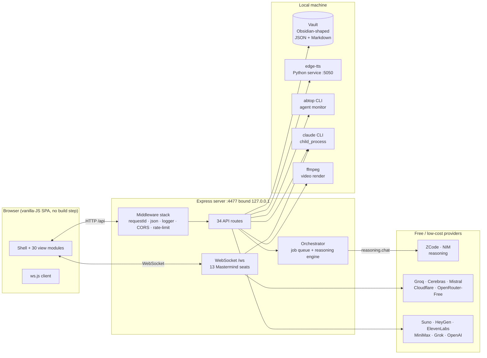
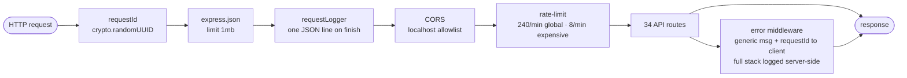
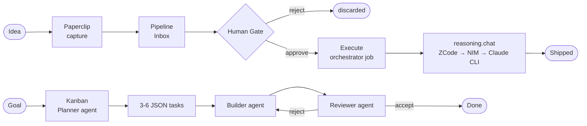
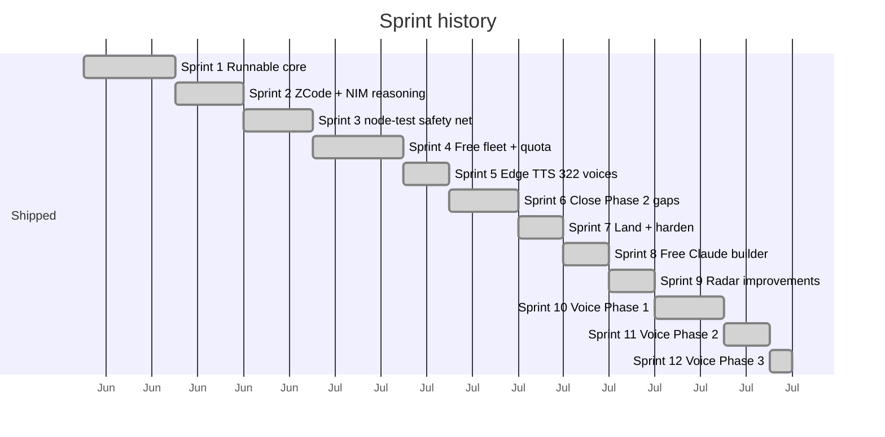

<div align="center">

# Agentic OS

**A local-first, single-user mission control for AI agents.**

One screen. One shared brain. One crew. Builds while you watch.

[](https://nodejs.org)
[](app/package.json)
[](app/package.json)
[](app/server.test.js)
[](app/server.js)
[](#license)

</div>

---

> **Honest-inert by design.** Missing keys, dead providers, and failed calls show up as `OFFLINE` / `DEGRADED` — never faked. Quota numbers are estimates. Errors surface verbatim. If something doesn't work, you see that it doesn't work.

Agentic OS runs entirely on your machine — no cloud, no account, no telemetry. Every agent shares one Obsidian-compatible **vault** so context is never re-explained. A reasoning engine resolves `ZCode → NIM → Claude CLI`, so the orchestrator runs without an Anthropic key. A fleet of free OpenAI-compatible providers (Groq, Cerebras, Mistral, Cloudflare, OpenRouter-Free) ships through one factory.

<p align="center">
  <em>Mission Control — the fleet at a glance.</em><br>
  
</p>

---

## Table of contents

- [Quickstart](#quickstart)
- [How it's built](#how-its-built)
- [Core features](#core-features)
- [The provider fleet](#the-provider-fleet)
- [How a request flows](#how-a-request-flows)
- [Orchestration workflow](#orchestration-workflow)
- [Screenshots](#screenshots)
- [Roadmap](#roadmap)
- [What's left](#whats-left)
- [Tech stack & layout](#tech-stack--layout)
- [Documentation](#documentation)
- [License](#license)

---

## Quickstart

**Windows** — double-click `Start Agent OS.bat`.

**Any platform**

```bash
cd app
npm install        # 3 deps, finishes in seconds
node server.js
```

Then open <http://localhost:4477>.

The server binds to `127.0.0.1` (loopback only) — the dashboard is unreachable from your LAN. Set `BIND=0.0.0.0` only if you deliberately want network exposure; the process-killing monitor endpoints stay loopback-gated either way.

Copy `app/.env.example` to `app/.env` and fill in keys as desired. The app boots **degraded without any keys** — the dashboard still loads and status tiles show exactly what's offline.

---

## How it's built



Everything inside the **Local** and **Server** boxes stays on your machine. Only the **Cloud** box leaves localhost, and only when a key is present.

---

## Core features

22 surfaces across 5 sidebar groups. Each row below is a real route in `app/public/js/sidebar-config.js`.

### 🛰️ Workspace — the dashboard layer

| Surface | What it does |
|---|---|
| **Mission Control** | Live status tiles for the whole fleet, one card per chat agent, heartbeat + latency. |
| **Provider Activity** | Real-time log of *your own* free-provider API calls — calls/min, tokens/min, success rate. |
| **Quota Tracker** | Estimated free-tier usage per provider against researched caps (labeled as estimates — no free API exposes real remaining quota). |
| **Agent Monitor** | Live Claude Code / Codex / OpenCode sessions on this machine, via the `abtop` CLI. Kill by PID (loopback-only). |

### 🧠 Agent Orchestration — the spine

| Surface | What it does |
|---|---|
| **Paperclip** | Idea intake → drops straight into Pipeline Capture. |
| **AI Agent Mastermind** | A 13-seat room streaming concurrently over WebSocket: Claude, Hermes, ZCode, NIM, Free-Claude, Gemini, Codex, GLM, Groq, OpenRouter-Free, Cerebras, Mistral, Cloudflare. `@mention` to filter seats. Every exchange auto-saves to the vault. |
| **Pipeline** | Capture → Human Gate → Execute → Shipped. Approve/reject/ship cards; Execute enqueues an orchestrator job. |
| **Agent Kanban** | Backlog → Building → Review → Done board, driven by Planner / Builder / Reviewer agents. |

### 💬 Agents — the chat fleet

Nine dedicated chat surfaces, all streaming over `/ws` with vault auto-save:

`Claude` · `Hermes` (Ollama) · `ZCode` (GLM-4.6) · `NVIDIA NIM` (Nemotron-70B) · `Groq` · `OpenRouter Free` · `Cerebras` · `Mistral` · `Cloudflare AI`

### 🪞 Self — your context

| Surface | What it does |
|---|---|
| **Memory** | Obsidian-vault notes rendered as a navigable **galaxy** — each note a star (size ∝ recency), each `[[wiki-link]]` an edge. |
| **Goals** | CRUD against `vault/Goals.md`, categories, progress stats. Voice-input supported. |
| **The Radar** | Free RSS signal aggregation (configure feeds via `RADAR_FEEDS`). Server-side fetch to avoid CORS. X/Grok paid APIs are a future enhancement. |
| **Free Claude Code** | Agent Factory UI for $0 local builds. *UI-ready; Claude Code CLI wiring into this view is in progress.* |

### 🎤 Voice Control — hands-free dashboard + computer access (Phase 1 + Phase 2)

#### Phase 1: Browser push-to-talk (included, always on)
**Hold Space** (or click the mic pill in the header) to speak a command. Your browser's native speech recognition (works in Chrome, Edge, Safari) sends audio to a local Ollama model, which interprets the utterance and executes tools — no voice transcription sent to the cloud.

**What you can do:**
- **Dashboard:** navigate to a surface, create/list/toggle/delete goals, capture a pipeline idea, list/advance/execute cards, build/assemble kanban items, ask an agent, check session status, kill a session by PID.
- **Computer:** open a folder in File Explorer, list a folder's contents, read a text file, compose an email (drafts the text; opens your mail client or Gmail compose — you click Send, nothing is auto-sent).

**Safety first:** dangerous actions (delete a goal, execute a card, assemble/build a kanban item, kill a session) require an explicit spoken confirmation — say "yes" when prompted. Confirmations expire after 30 seconds.

**Configuration:**
- Requires a local Ollama model running with JSON tool-calling capability (e.g., `qwen3`, `llama3.1-8B`).
- Spoken replies use the same edge-tts service as Voice Studio; falls back to the browser's speech synthesis if edge-tts isn't running.
- Filesystem access is sandboxed to folders you specify in `VOICE_ALLOWED_DIRS` (defaults to your home directory).
- See `app/.env.example` for all tuning: `VOICE_ENABLED`, `VOICE_OLLAMA_MODEL`, `VOICE_TTS_VOICE`, `VOICE_CONFIRM_TTL_MS`, `VOICE_EMAIL_MODE`.

**Honest degradation:** The mic pill shows `VOICE OFFLINE` if Ollama is unreachable. Tool errors surface plainly — no silent failures.

#### Phase 2: Fully-local speech-to-speech (optional, off by default)
Run a local speech-to-speech pipeline with **no browser tab open** — a true open-mic hands-free loop. The pipeline (Silero VAD + faster-whisper STT + Kokoro TTS) runs as a managed child process and uses the dashboard as its reasoning backend via an OpenAI-shaped `/voice/v1/chat/completions` endpoint. Same 20-tool agent brain as Phase 1; same danger confirmations.

**To enable Phase 2:**
1. Run `powershell -ExecutionPolicy Bypass -File app/services/setup-s2s.ps1` — installs the pipeline venv, downloads models (~2 GB first run), detects CUDA/CPU, verifies espeak-ng, lists audio devices.
2. Set `S2S_AUTOSTART=true` in `app/.env` (off by default — it's heavier and more experimental than Phase 1).
3. Server restarts automatically; watch `/api/voice/status` dashboard tile for `s2s` process state.

**What Phase 2 adds:** hands-free without a browser tab, no Web Speech API dependency, true open-mic listening. **Known validation gap:** end-to-end live testing with a real installed pipeline and microphone has not been performed in this dev environment; see `app/services/README.md` section "Unverified in this environment" for the specific checklist items and how to verify them on a live install.

**Honest caveats:** The upstream `speech-to-speech` Python project is untested on Windows; multi-GB model downloads; open-mic has no additional auth once enabled (stay on `127.0.0.1` loopback only). Phase 2 is experimental and opt-in.

#### Phase 3: Voice HUD observability view (included, ready to use)
A dedicated, same-tab live view of voice activity — what was heard, what tools ran with their arguments and results, agent replies, and pending confirmations — all in one causally-ordered feed. Accessible via the sidebar under Workspace (next to Mission Control and Agent Monitor).

**What it shows:**
- Merged chronological log of all voice events from the current browser tab since page load: utterances, tool calls (arguments + success/error), agent replies, and active confirmations.
- Health panel: voice brain (Ollama) reachability, S2S child status (if enabled), TTS status, plus a mute toggle.
- Interactive Confirm/Cancel banner for pending danger-tier confirmations, using the same underlying WebSocket mechanism as Phase 1 and Phase 2.

**Scope (intentional):** This view shows activity only from the current browser tab, starting when the page loaded. It has no cross-tab history, no persistence across reload, and no access to activity that happened before the page opened. This is a deliberate investigation-backed choice, not a limitation to apologize for — the UI states this plainly.

**Under the hood:** Pure client-side. The backend `/api/voice/status` endpoint is unchanged; the view consumes it for health status. A small extension to the existing Phase 1 `voice-control.js` module adds an in-memory event history and subscription API so this view (and future consumers) can observe voice activity. Zero changes to any server-side voice code (brain, tools, WebSocket protocol, or S2S transport).

### 🎬 Studio — generation surfaces

| Surface | Engine | Status |
|---|---|---|
| **Game Studio** | Reasoning engine → single-file HTML game | ✅ Live |
| **Thumbnail Studio** | OpenAI `gpt-image-1` generate/edit | ✅ Live |
| **Music Studio** | Suno (via sunoapi.org proxy) | ✅ Live |
| **Video Studio** | HeyGen/ElevenLabs narrator + MiniMax/Grok b-roll, **combined via ffmpeg** | ✅ Live |
| **Voice Studio** | Free Microsoft Neural TTS via edge-tts — 322 voices | ✅ Live · *UNOFFICIAL* |

<p align="center">
  <em>Memory Galaxy — vault notes as a navigable starfield.</em><br>
  
</p>

---

## The provider fleet

The reasoning engine (used by the orchestrator) resolves in priority order: **ZCode → NIM → Claude CLI fallback**, so Pipeline Execute / Kanban build / review jobs run without an Anthropic key. The chat fleet is OpenAI-SSE-compatible, built from one factory (`lib/providers/openai-compat.js`).

| Provider | Kind | Model | Free-tier cap | Powers | Status |
|---|:---:|---|---|---|:---:|
| **ZCode** | chat | Z.AI GLM-4.6 | Z.AI coding plan | Reasoning engine (primary), chat seat | ✅ |
| **NVIDIA NIM** | chat | Nemotron-70B | ~1,000 credits · 40 RPM | Reasoning engine (fallback), chat seat | 🧪 trial |
| **Groq** | chat | Llama 3.3 70B | ~14,400 req/day · 30 RPM | Chat seat, Mastermind seat | ✅ |
| **Cerebras** | chat | Llama 3.1 8B | ~1M tokens/day | Chat seat, Mastermind seat | ✅ |
| **Mistral** | chat | mistral-small-latest | ~1 req/sec | Chat seat, Mastermind seat | ✅ |
| **Cloudflare AI** | chat | Llama 3.3 70B fp8 | 10,000 Neurons/day | Chat seat, Mastermind seat | ✅ |
| **OpenRouter Free** | chat | `openrouter/free` router | ~50 req/day | Chat seat, Mastermind seat | ✅ |
| **Edge TTS** | tts | 322 Microsoft Neural voices | Unlimited | Voice Studio, video narration | ⚠️ unofficial |
| **Ollama** | chat | any local model | unlimited | Hermes seat, Voice Control (Phase 1) | ✅ local |
| **Claude Code CLI** | chat | claude (binary) | Anthropic key | Claude seat, reasoning fallback | ✅ |
| OpenAI Images | media | `gpt-image-1` | paid | Thumbnail Studio | 🔧 key-gated |
| Suno | media | Suno API | paid | Music Studio | 🔧 key-gated |
| HeyGen · ElevenLabs | media | avatar · voiceover | paid | Video Studio narrator | 🔧 key-gated |
| MiniMax · Grok | media | b-roll video | paid | Video Studio b-roll | 🔧 key-gated |

**Legend:** ✅ wired · 🧪 trial (finite credits) · ⚠️ unofficial (personal use only) · 🔧 key-gated (honest-OFFLINE without key)

> The Edge TTS integration reverse-engineers Microsoft Edge's Read Aloud endpoint. It is **UNOFFICIAL and personal/hobby use only** — not licensed for commercial deployment. See [`app/services/README.md`](app/services/README.md).

---

## How a request flows

The Sprint 7 hardening stack — every request passes through these in order:



A user-reported `requestId` maps to exactly one server log line. Stack traces never leak to the client.

---

## Orchestration workflow

Two coordinated boards drive work from idea to shipped artifact. The orchestrator is a persisted job queue with concurrency control and honest failure (restarted jobs are marked `failed`, never fake-resumed).



Every orchestrator job streams progress over WebSocket to all connected clients.

---

## Screenshots

<p align="center">
  <table>
    <tr>
      <td width="50%" align="center"><b>Pipeline — Capture → Human Gate → Execute → Shipped</b></td>
      <td width="50%" align="center"><b>Agent Kanban — Planner / Builder / Reviewer</b></td>
    </tr>
    <tr>
      <td></td>
      <td></td>
    </tr>
    <tr>
      <td align="center"><b>Mastermind — 13 concurrent seats</b></td>
      <td align="center"><b>The Radar — signals + oracle</b></td>
    </tr>
    <tr>
      <td></td>
      <td></td>
    </tr>
  </table>
</p>

More captures in [`Dashboard Assets/built/`](Dashboard%20Assets/built/) — goals, game studio, video studio, music studio, thumbnail studio, palette, and more.

---

## Roadmap

Eleven sprints shipped. Linear history on `main`. 240 tests green throughout, zero new dependencies added in any sprint.



| Sprint | Scope |
|---|---|
| **1** | Runnable core: Mission Control, Express server, vault, `/api/status` probes, SPA shell |
| **2** | ZCode + NVIDIA NIM reasoning engines — orchestrator runs without an Anthropic key |
| **3** | `node:test` safety net (10 suites across state modules + server smoke) |
| **4** | Free-provider fleet (7 providers) + activity monitor + Quota Tracker |
| **5** | Free Microsoft Neural TTS via edge-tts (322 voices, unofficial) |
| **6** | Close Phase 2 gaps: full-fleet Mission Control cards, Web Speech voice input, Video Studio ffmpeg render, Radar RSS MVP. *(Memory Galaxy was already wired — verified, no change needed.)* |
| **7** | Land sprints 1–6 to `main`, then harden: loopback bind, loopback-only kill endpoints, zero-dep rate limiter, structured JSON logger + requestId, centralized error middleware, graceful shutdown, explicit CORS, this README + ROADMAP |
| **8** | Wire Free Claude Code Agent Factory + Chat & Workspace |
| **9** | Free-only Radar improvements: dedup, keyword scoring, Draft this button |
| **10** | Voice Control Phase 1: hands-free push-to-talk, Ollama JSON agent, 20-tool catalog, confirmation gating on danger actions, pre-ship security audit |
| **11** | Voice Control Phase 2: fully-local speech-to-speech pipeline (Silero VAD + faster-whisper + Kokoro TTS) as optional child process, browser-free open-mic, confirmation fix + transport-agnostic brain, security review, test growth |
| **12** | Voice Control Phase 3: Voice HUD observability view, merged chronological log, health panel, confirmation banner, same-tab-only scope, zero server changes |

Full history with per-commit detail in [`ROADMAP.md`](ROADMAP.md).

---

## What's left

**Deferred by design** (not oversights):

- **Auth / multi-user** — single-user local-first is the product. Loopback bind + loopback-only kill endpoints close the network exposure without auth complexity.
- **Next.js / React migration** — `the-agent-operating-system Idea.txt` references it; the shipped codebase is intentionally a no-build vanilla-JS SPA.
- **Express 5 upgrade** — GA, but carries subtle breaking-change risk; separate from hardening.

**Ranked feature ideas** (from the gap audit — not committed):

| Priority | Feature | Honest status |
|---|---|---|
| High | Radar X/Grok live API wiring | Free RSS MVP shipped (Sprint 6); paid X/Grok APIs are the original vision |
| High | Free Claude Code: full builder wiring | Agent Factory UI ready; Claude Code CLI plumbing into this view in progress |
| Med | Video Studio: Create + Avatar tabs | "coming in Phase 2" placeholders |
| Med | Session picker for Claude Code `--resume` | The flag works; no UI to choose which past session |
| Low | Omi device sync | Memory surface is vault-wired; physical Omi recorder sync is a device-integration feature |
| Low | Hermes Goal Mode / profiles / Jarvis / MCP tabs | Listed placeholders |

---

## Tech stack & layout

| Layer | Choice |
|---|---|
| Backend | Node.js + Express 4 + `ws` — **3 production deps, 0 dev deps** (deliberate minimalism) |
| Frontend | Hand-written vanilla-JS SPA — no framework, no bundler, no build step |
| Data | Filesystem "vault" (`app/vault/`) — JSON + Markdown, Obsidian-compatible |
| Realtime | WebSocket `/ws` for chat streaming + Mastermind room + job broadcast |
| Tests | Built-in `node:test` runner — 98 tests, 10 suites |
| Logging | Zero-dep structured JSON to stdout, keyed by `requestId` |
| Rate limiting | Zero-dep token-bucket — 240/min global, 8/min on expensive routes |

```
the-agent-operating-system/
├── app/
│   ├── server.js              # Express + WebSocket server (~1080 lines)
│   ├── package.json           # 3 prod deps, 0 dev deps
│   ├── lib/                   # 19 modules: vault, providers/, orchestrator,
│   │                          #   probes, reasoning, rate-limit, logger, video-render, radar-feeds
│   ├── public/                # vanilla-JS SPA
│   │   ├── css/               # 20 surface stylesheets + tokens.css
│   │   ├── js/                # shell, router, palette, ws, sidebar-config
│   │   │   └── views/         # 30 ES-module view files
│   │   └── fonts/             # 4 self-hosted variable woff2 fonts
│   ├── services/              # edge-tts Python service (unofficial)
│   └── vault/                 # your data — gitignored
├── Dashboard Assets/          # product screenshots (committed)
├── ROADMAP.md                 # full sprint history
└── Start Agent OS.bat         # Windows launcher
```

---

## Documentation

- 📜 **[ROADMAP.md](ROADMAP.md)** — full sprint history, deferred items, feature ideas
- 🛠️ **[app/README.md](app/README.md)** — developer guide: architecture, request pipeline, running, testing, how to add a provider, hardening posture
- ⚙️ **[app/.env.example](app/.env.example)** — every configuration knob, documented inline with free-tier caps
- 🔊 **[app/services/README.md](app/services/README.md)** — edge-tts Python service (unofficial / personal-use caveat)

---

## License

Personal / hobby use. The bundled **edge-tts** integration reverse-engineers Microsoft Edge's Read Aloud endpoint and is **not licensed for commercial deployment** (violates Microsoft ToS). Provider integrations (OpenAI, Suno, HeyGen, ElevenLabs, MiniMax, Grok) require their respective API keys and are subject to those providers' terms. No warranty. See [`app/services/README.md`](app/services/README.md) for details.

---

<div align="center">

*Designed for the local-first operator. Built honestly.*

</div>
