<div align="center">


<a href="https://github.com/HailLucifer666/Agent_OS">
  
</a>

<br/>

[](https://nodejs.org)
[](https://github.com/HailLucifer666/Agent_OS/actions)
[](ROADMAP.md)
[](#-146-tool-effectors)
[](https://agent-os-7gg5.onrender.com)
[](#%EF%B8%8F-license)

<br/>

<picture>
  <source media="(prefers-color-scheme: dark)" srcset="Dashboard Assets/built/mission-control.png">
  
</picture>

<em>🛰️ The JARVIS HUD — radial neural map, live entity state, voice mesh.</em>

</div>

---

> [!IMPORTANT]
> **Honest-inert by design.** Missing keys, dead providers, failed calls show up as `OFFLINE` / `DEGRADED` — never faked. Quota numbers are estimates. Errors surface verbatim. If something doesn't work, you *see* that it doesn't work.

A living system with an OODA loop, layered memory, tiered autonomy, immune system, and 5347 tests.

<div align="center">

### 🧭 Navigate

[**Architecture**](#-architecture-overview) · [**OODA Loop**](#-the-ooda-cognitive-loop) · [**Brain**](#-brain--multi-provider-chain) · [**Memory**](#%EF%B8%8F-memory-system) · [**Immune System**](#%EF%B8%8F-immune-system) · [**Safety**](#-tiered-autonomy--safety) · [**Voice**](#%EF%B8%8F-voice-system) · [**146 Tools**](#-146-tool-effectors) · [**Engagements**](#-engagement-layer--structured-task-lifecycle) · [**Deploy**](#-deploy) · [**Screenshots**](#-screenshots) · [**History**](#-build-history) · [**Stack**](#%EF%B8%8F-tech-stack) · [**Docs**](#-documentation)

</div>

---

## 🌐 Architecture Overview

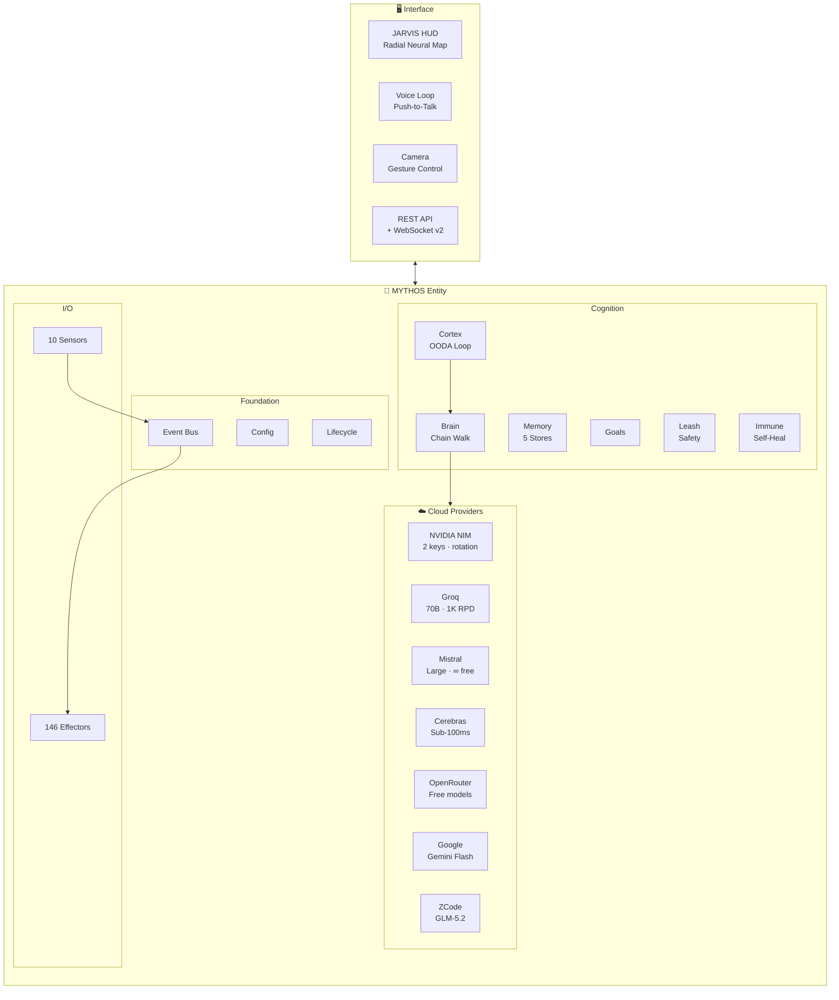

### ⚔️ Entity vs Agent

| Property | 🤖 Traditional Agent | 🔮 **MYTHOS Entity** |
|----------|----------------------|----------------------|
| **Trigger** | User request | OODA cognitive loop (1s tick) |
| **Cognition** | On-demand chain walk | Continuous cortex tick |
| **Memory** | Session-only | Layered persistent memory (5 stores) |
| **Safety** | Confirm dialog | Tiered autonomy + audit trail + immune |
| **Failure** | Return error | Self-diagnose → self-heal → degrade |
| **Idle** | No work, no cost | Idle ticks call zero LLM APIs |
| **Deployment** | Serverless | Long-running process + Docker |

---

## 🔄 The OODA Cognitive Loop

Every second, MYTHOS runs a full **observe → orient → decide → act** cycle:

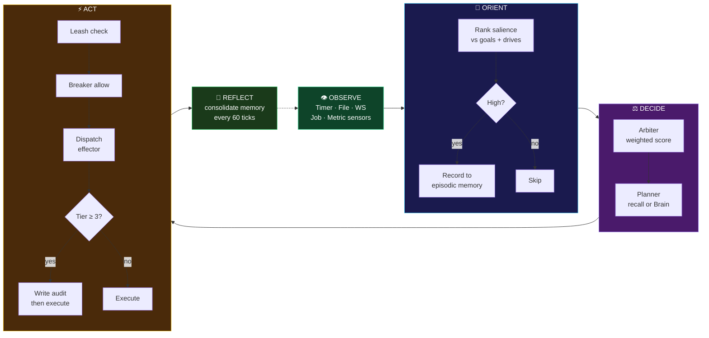

> [!TIP]
> **Key insight:** Idle ticks skip Brain entirely — no LLM call, no cost. Only salient perceptions trigger reasoning.

---

## 🏛️ Six-Layer Stack

```
┌─────────────────────────────────────────────────────┐
│              SERVER & UI v2                          │  Express + WS on :4478
│         JARVIS HUD · Voice · Camera                  │  Vanilla JS, zero build step
├─────────────────────────────────────────────────────┤
│              IDENTITY                                │  self.md · boundaries.md
│         Human-editable persona                       │  Entity has no write path
├─────────────────────────────────────────────────────┤
│     SENSORS   ←→   BUS   ←→   EFFECTORS             │  11 sensors · 146 effectors
│  timer·file·ws·job·metric·gmail·screen·window·       │  Publish/subscribe, never direct
│  reminder·calendar                                   │
├─────────────────────────────────────────────────────┤
│              CORTEX (OODA)                            │  1s tick, generation guard
│         observe → orient → decide → act               │  Breakers + timeouts
├─────────────────────────────────────────────────────┤
│  GOALS  │  BRAIN  │  LEASH  │  IMMUNE               │  Cognition subsystems
│  Arbitrage  Chain   Audit    Heal                    │
├─────────────────────────────────────────────────────┤
│           MEMORY (5 stores)                           │  Episodic · Semantic
│           Skills · Identity · Audit                   │  Vault-backed, persistent
├─────────────────────────────────────────────────────┤
│  CONFIG  │  BUS  │  LIFECYCLE  │  LOGGER            │  Foundation
└─────────────────────────────────────────────────────┘
```

> [!NOTE]
> **Wiring rule:** Modules never call across layer boundaries directly — publish/subscribe on bus. Cortex is the only module that holds direct refs to memory, goals, brain, leash, and effectors.

---

## 🧠 Brain — Multi-Provider Chain

**7 cloud providers** (NVIDIA NIM with 2-key rotation, Groq, Mistral, Cerebras, OpenRouter, Google, ZCode) plus a **local Ollama fallback** — 8 lanes total, walking ranked preference tables with per-model cooldown.

```mermaid
flowchart LR
    THINK["brain.think()"] --> REG["Registry<br/>probe all providers"]

    subgraph Chain["Chain Walk"]
        direction LR
        A1["Groq 70B"] -->|fail| A2["Mistral Large"]
        A2 -->|fail| A3["Cerebras Gemma"]
        A3 -->|fail| A4["NIM Key 1"]
        A4 -->|fail| A5["NIM Key 2"]
        A5 -->|fail| A6["Google<br/>Gemini Flash"]
        A6 -->|fail| A7["OpenRouter"]
        A7 -->|fail| A8["ZCode GLM<br/>lane-config gated"]
        A8 -->|fail| A9["Ollama ∞"]
    end

    A9 -->|fail| DEAD["chainExhausted<br/>offline: true"]
    A1 -->|success| RESP["Response"]

    style A1 fill:#0e4429,stroke:#43e5a0
    style A2 fill:#0e4429,stroke:#43e5a0
    style A3 fill:#0e4429,stroke:#43e5a0
    style DEAD fill:#4a0a0a,stroke:#ef4444
    style RESP fill:#0e4429,stroke:#22c55e
```

### 🛰️ Provider Fleet

| Provider | Model(s) | Free Tier | Lanes | Rotation |
|----------|----------|-----------|-------|:--------:|
| **Groq** | `llama-3.3-70b-versatile` | 1K RPD / 100K TPD | voice, simple | — |
| **Mistral** | `mistral-large-2512` | No cap · 1 req/sec | voice, build, simple, vision | — |
| **Cerebras** | `gemma-4-31b`, `zai-glm-4.7`, `gpt-oss-120b` | 2.4K RPD | build, simple, text | — |
| **NVIDIA NIM** | `meta/llama-3.1-8b-instruct`, vision models | ~1K/month · 40 RPM | voice, build, simple, text, vision | ✅ 2 keys |
| **OpenRouter** | `hermes-3-405b`, `qwen3-coder`, `llama-3.3-70b` | 50 RPD | voice, build, simple, text | — |
| **Ollama** | `qwen3:8b`, `ornith:9b`, `qwen3.5`, `qwen2.5vl` | Unlimited (local) | voice, build, simple, text, vision | — |
| **Google** | `gemini-flash-lite-latest` (+ `gemini-3.6-flash`, `gemini-flash-latest` per lane) | Flash-tier only — free keys get 429 on every Pro-tier Gemini model | voice, simple, text, vision | — |
| **ZCode** | `glm-4.6` | — | none by default (lane-config gated) | — |

### 🔀 Failover Chains per Lane

```mermaid
graph TD
    subgraph Voice["🎙️ VOICE"]
        V1["Groq 70B"] --> V2["Mistral Large"] --> V3["Cerebras"] --> V4["NIM"] --> V5["OpenRouter"] --> V6["Ollama"]
    end
    subgraph Build["🏗️ BUILD"]
        B1["Mistral Large"] --> B2["Cerebras GLM-4.7"] --> B3["Cerebras GPT-OSS"] --> B4["OpenRouter"] --> B5["NIM"] --> B6["Ollama"]
    end
    subgraph Simple["✉️ SIMPLE"]
        S1["Mistral"] --> S2["Cerebras"] --> S3["NIM"] --> S4["OpenRouter Hermes"] --> S5["Ollama"]
    end
    subgraph Vision["👁️ VISION"]
        VN1["Mistral (multimodal)"] --> VN2["NIM Vision"] --> VN3["Ollama qwen3.5"] --> VN4["Ollama qwen2.5vl"]
    end
```

---

## 🗄️ Memory System

Five persistent stores, vault-backed, layered from short-term to long-term:

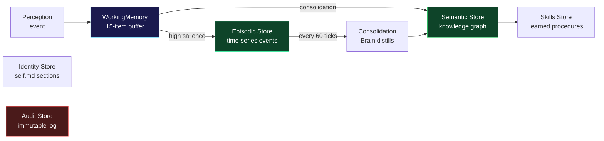

| Store | Purpose | Retention | Format |
|-------|---------|-----------|--------|
| 🧠 **Working Memory** | 15-item perception buffer, drain on orient | Tick-scoped | In-memory |
| 📼 **Episodic** | Time-series of events and experiences | 30 days (config) | JSON files |
| 🕸️ **Semantic** | Consolidated knowledge, relationships | Permanent | JSON + vector index |
| 🛠️ **Skills** | Learned procedures and patterns | Permanent | JSON |
| 🪪 **Identity** | Persona sections (self.md, boundaries.md) | Permanent | Markdown |
| 📜 **Audit** | Immutable action log for tier ≥ 3 | Permanent | JSON lines |

---

## 🛡️ Immune System

Self-healing architecture with watchdog, healer, diagnostician, and circuit breakers:

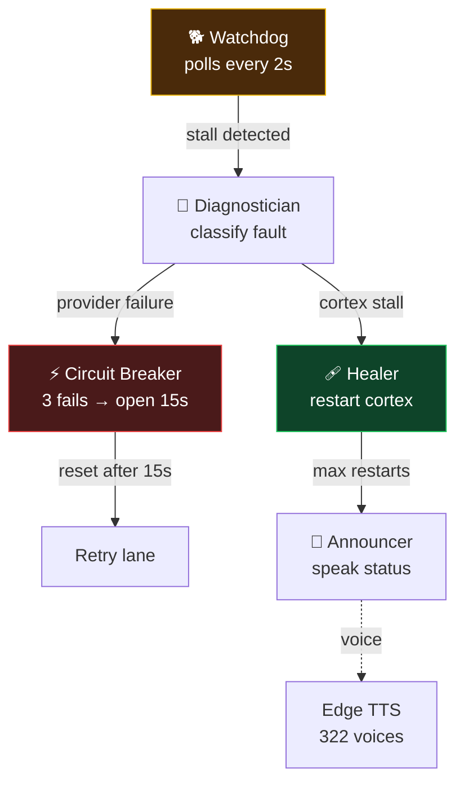

| Component | Role | Trigger |
|-----------|------|---------|
| 🐕 **Watchdog** | Detects cortex stalls | Polls every 2s |
| 🔬 **Diagnostician** | Classifies fault type | Stall or anomaly event |
| ⚡ **Breakers** | Trip on 3 consecutive fails | Provider-level circuit |
| 🩹 **Healer** | Restarts failed subsystems | Diagnostician dispatch |
| 📢 **Announcer** | Voice status updates | Health events |
| 💾 **Monitor** | Crash recovery on restart | Boot-time checkpoint scan |

---

## 🔐 Tiered Autonomy & Safety

Four tiers of action autonomy with **human sovereignty baked in**:

| Tier | Actions | Human Gate | Audit |
|:----:|---------|:----------:|:-----:|
| **0** | Internal state changes | — | — |
| **1** | Memory writes, perception routing | — | — |
| **2** | Goal CRUD, kanban moves, pipeline advance | — | ✅ |
| **3** | Code execution, file writes, agent dispatch | Confirm | ✅ |
| **4** | System-level changes, destructive ops | Confirm + reason | ✅ |

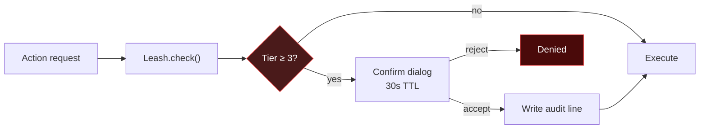

> [!TIP]
> **`MYTHOS_DRY_RUN=true`** — makes all tier ≥ 1 actions logged no-ops. Perfect for observing what the entity *would* do.

---

## 🎙️ Voice System

Three integrated voice channels — browser push-to-talk, speech-to-speech pipeline, and gesture control:

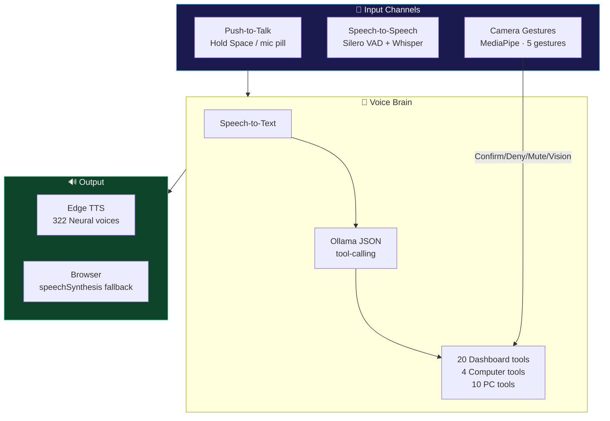

### ✋ Gesture Control

| Gesture | Action |
|:-------:|--------|
| 👍 **Thumb Up** | Accept confirmation |
| ✊ **Closed Fist** | Reject confirmation |
| 🖐️ **Open Palm** | Mute the mic — or unmute it, if it is already off |
| ☝️ **Pointing Up** | Unmute the mic (only ever unmutes, never mutes) |
| ✌️ **Victory** | Vision Q&A — describe scene |

A pose is **one press, however long you hold it**: the same gesture cannot fire
again until your hand leaves it, so a palm left in frame mutes once instead of
flipping the mic back on. Mute is also reachable from the mic button, the core
orb, and the global push-to-talk hotkey (`Alt+Space` by default).

### 👁️ What the camera can and cannot see

Camera is **OFF by default**, the same privacy posture as the mic, and `stop()`
releases the hardware stream rather than only the timer.

While it is on, gesture recognition runs **entirely on your machine** — MediaPipe
WASM, no server round-trip, no frames leaving the process. A single JPEG frame is
sent to the vision model **only** when you ask for it: the ✌️ gesture, or an
utterance like *"what do you see"*, *"look at this"*, *"can you see this"*,
*"what am I holding"*. One question, one frame.

Webcam frames are **never** streamed continuously to the Live session — that is
screen-share only. So MYTHOS can look when asked; it is not watching the room.

### 🗣️ Voice Actions

- **Dashboard** — navigate, goals CRUD, pipeline capture/advance, kanban build, ask agents
- **Computer** — open folders, list files, read files, compose emails
- **Safety** — dangerous actions require spoken confirmation (30s TTL)

---

## 146-Tool Effectors

🧰 Every action MYTHOS can take goes through one of these 146 registered effectors. Counts are generated (`mythos/scripts/sync-test-count.js`, AD-10) from the real `from-*.js` tool arrays — not hand-typed:

- [146-Tool Effectors](#146-tool-effectors) — the full catalog, generated from the real `from-*.js` arrays.

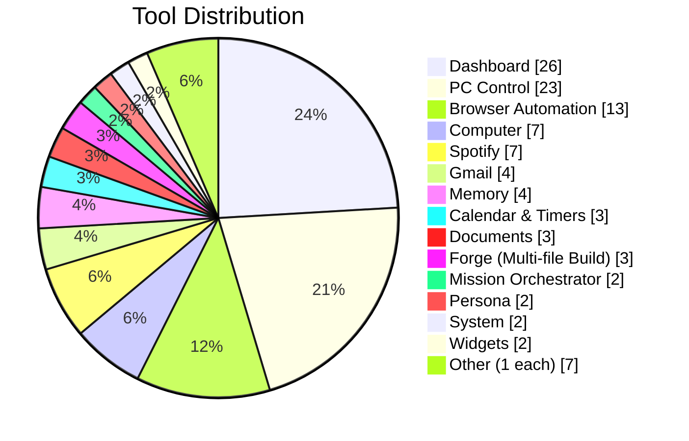

<details>
<summary><b>📋 Full effector catalog (click to expand)</b></summary>

<br/>

| Catalog | Count | Examples |
|---------|:-----:|----------|
| **Dashboard** | 26 | navigate, create_goal, pipeline_execute, kanban_build_card, ask_agent, read_status |
| **PC Control** | 23 | launch_app, focus_window, screen_look, ui_click, ui_type, media_key |
| **Browser Automation** | 13 | browser_navigate, browser_click, browser_screenshot, browser_evaluate |
| **Computer** | 7 | open_folder, list_folder, read_file, delete_file, compose_email |
| **Spotify** | 7 | spotify_play_pause, spotify_next, spotify_search, spotify_status |
| **Gmail** | 4 | gmail_unread, gmail_read, gmail_send |
| **Memory** | 4 | remember, recall_memory, log_incident, self_capabilities |
| **Calendar & Timers** | 3 | reminder_add, reminder_list, reminder_cancel |
| **Documents** | 3 | generate_spreadsheet, generate_deck, generate_pdf |
| **Forge (Multi-file Build)** | 3 | build_project, revise_project, project_status |
| **Mission Orchestrator** | 2 | run_mission, mission_status |
| **Persona** | 2 | persona_status, set_persona_level |
| **System** | 2 | get_time, get_weather |
| **Widgets** | 2 | spawn_widget, manage_widget |
| **Hermes Build Engine** | 1 | hermes_task |
| **GitHub Installer** | 1 | install_from_github |
| **Project** | 1 | start_project (auto-pipeline) |
| **Command Runner** | 1 | run_command (allowlist-gated) |
| **Skills** | 1 | use_skill |
| **Voice** | 1 | speak (edge-tts, registered directly) |

</details>

> [!WARNING]
> All dangerous tools (delete, execute, kill) require confirmation via the Leash system.

---

## 📋 Engagement Layer — Structured Task Lifecycle

Takes an intent (a sentence) and walks it through a structured lifecycle: **interview → spec → plan → approval → execution → verification → repair → completion**.

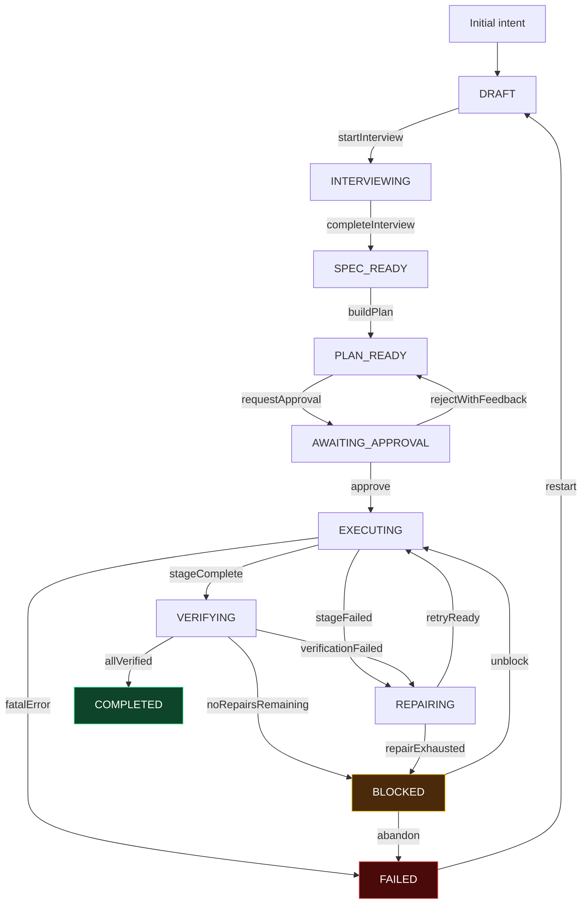

| Capability | Modules | What it does |
|-----------|---------|--------------|
| **State Machine** | `state-machine.js`, `schema.js` | 12 states, 22 validated transitions with preconditions. Invalid transitions emit typed health anomalies. |
| **Interview** | `interview.js`, `interview-card` UI | Up to 5 questions, 5 variants (text, choice, confirm, multi-select, numeric), per-type validation. |
| **Spec Builder** | `spec-builder.js`, `recommendations.js` | Generates markdown specs from interview answers. Recommends build/research/hybrid approaches with confidence scores. |
| **Plan Builder** | `plan-builder.js` | Produces staged plans (setup, core, verify) with verification gates per stage. |
| **Progress** | `progress.js`, `progress-stream` UI | Real-time progress tracking, percentage-complete, repair budget monitoring. |
| **Conversation Gateway** | `gateway.js`, `intent-router.js` | Classifies messages as action/question/chat with 9 engagement action patterns. |
| **Events** | `events.js` | 18 typed bus event factories covering the full lifecycle. |

**Backend** (15 modules): `src/core/engagements/` (10) + `src/core/assistant/` (5).
**Frontend** (8 component + 3 view modules): 3-column dashboard, 5-tab detail panel, live WS-driven progress streaming, approval gate modals, interview cards, verification check cards, completion reports.
**Tests:** 166 tests (121 engagement + 45 assistant) across 14 test files.

---

## 🚀 Deploy

### ☁️ Render (Cloud)

```yaml
# render.yaml — auto-detected by Render Blueprint
services:
  - type: web
    name: agent-os
    runtime: docker
    rootDir: mythos
    plan: free
    envVars:
      - key: PORT
        generateValue: true
      - key: MYTHOS_BIND
        value: "0.0.0.0"
```

**Deploy steps:**
1. Push to `main` — auto-deploys
2. Set env vars in Render dashboard (API keys, model configs)
3. Live at `https://agent-xxxx.onrender.com`

**Dockerfile included** — Node 20 Alpine + edge-tts + zero build step.

> [!IMPORTANT]
> **Environment variables** (set in Render dashboard, NOT in the repo):
> `NIM_API_KEY` · `NIM_API_KEY_2` · `GROQ_API_KEY` · `MISTRAL_API_KEY` · `OPENROUTER_API_KEY` · `CEREBRAS_API_KEY`

### 💻 Local (Windows)

Double-click **`Start Agent OS.bat`** — that's it.

```bash
# Or manually:
cd mythos
npm install
node src/main.js
# Open http://127.0.0.1:4478
```

Copy `.env.example` to `.env` and fill in keys. Boots **degraded without any keys** — status tiles show exactly what's offline.

---

## 📸 Screenshots

<div align="center">

| 🛰️ JARVIS HUD — Radial Neural Map | 🗂️ Agent Kanban — Planner / Builder / Reviewer |
|:---:|:---:|
|  |  |
| 🌌 **Memory Galaxy — Vault as a Starfield** | 🎯 **Goals — CRUD + Voice Input** |
|  |  |
| ⚙️ **Pipeline — Capture → Gate → Execute → Ship** | 📡 **The Radar — RSS Signal Aggregation** |
|  |  |
| 🧠 **Mastermind — 13 Concurrent AI Seats** | 🤖 **Agent Room — Multi-Model Streaming** |
|  |  |

| 🎮 Game Studio | 🎵 Music Studio | 🎬 Video Studio | 🖼️ Thumbnail Studio |
|:---:|:---:|:---:|:---:|
|  |  |  |  |

</div>

---

## 📈 Build History

**20 phases shipped.** Linear history on `main`. 5347 tests green.

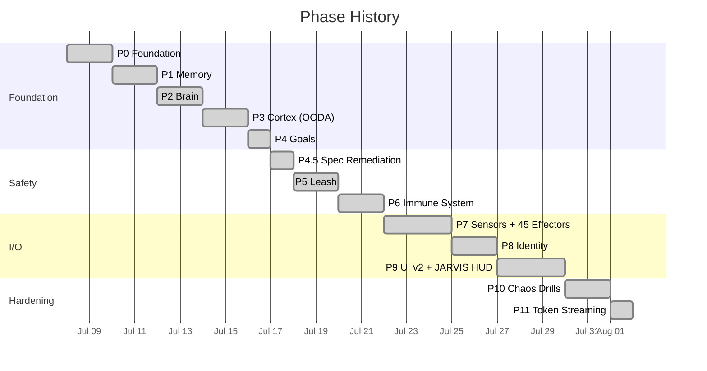

<details>
<summary><b>📊 Test growth per phase (click to expand)</b></summary>

<br/>

| Phase | Scope | Tests |
|:-----:|-------|:-----:|
| **P0** | Foundation: config, bus, lifecycle, logger, vault | 26 |
| **P1** | Memory: 5 stores, consolidation, working memory | 70 |
| **P2** | Brain: chain walk, provider registry, failover | 113 |
| **P3** | Cortex: OODA loop, orient/decide/act cycle | 161 |
| **P4** | Goals: arbitrage, budget, CRUD, priority scoring | 161 |
| **P4.5** | Spec-conformance remediation (13 criticals closed) | 174 |
| **P5** | Leash: tiered autonomy, confirmation gating, audit | 184 |
| **P6** | Immune: watchdog, healer, breakers, announcer | 234 |
| **P7** | 45 effectors, 5 sensors, voice, build-runner | 272 |
| **P8** | Identity: self.md, boundaries.md, persona injection | 293 |
| **P9** | UI v2: JARVIS HUD, WS v2, REST routes, overlay panels | 316 |
| **P10** | Chaos drills: 6 drills against real shipped code | 327 |
| **P11** | Token streaming, gap-closing (D-23/D-57 fixes) | 402 |
| **P17/18** | Engagement Layer: lifecycle FSM, interview, spec, plan, store, assistant, UI | 568 |

</details>

Full history: [ROADMAP.md](ROADMAP.md) · [MYTHOS-ARCHITECTURE.md](MYTHOS-ARCHITECTURE.md)

---

## 🛠️ Tech Stack

<div align="center">


</div>

<br/>

| Layer | Choice | Rationale |
|-------|--------|-----------|
| **Runtime** | Node.js ≥ 18 | Zero config, universal |
| **Server** | Express 4 + `ws` | Battle-tested, minimal |
| **Frontend** | Vanilla JS SPA | No framework, no bundler, no build step |
| **UI** | JARVIS HUD (Canvas) | Radial neural map, floating widgets |
| **Data** | Filesystem vault | Obsidian-compatible JSON + Markdown |
| **Realtime** | WebSocket v2 | Streaming, broadcasts, subscriptions |
| **Voice** | Edge TTS + Web Speech API | 322 Microsoft Neural voices, free |
| **Vision** | MediaPipe gestures | 5 gestures: confirm, deny, mute, unmute, vision |
| **Tests** | Built-in `node:test` | 5347 tests, zero test framework deps |
| **Deps** | 9 total | `@huggingface/transformers` · `@mediapipe/tasks-vision` · `exceljs` · `express` · `kokoro-js` · `onnxruntime-web` · `playwright-core` · `pptxgenjs` · `ws` |
| **Deploy** | Docker (Render) | One `Dockerfile`, auto-deploy on push |

<details>
<summary><b>📁 Project layout (click to expand)</b></summary>

<br/>

```
Agent_OS/
├── mythos/                      # MYTHOS entity runtime
│   ├── Dockerfile               # Docker image for cloud deploy
│   ├── .env.example             # All config knobs (documented)
│   ├── package.json             # 9 deps, 5347 tests
│   ├── src/
│   │   ├── main.js              # Boot sequence (13 lifecycle steps)
│   │   └── core/
│   │       ├── brain/           # chain.js, registry.js, lanes, spend
│   │       ├── bus/             # Event bus (pub/sub, middleware, storm guard)
│   │       ├── config/          # Schema validation + env loading
│   │       ├── cortex/          # OODA loop + orient/decide
│   │       ├── effectors/       # 146 tools, build-runner, orchestrator
│   │       ├── goals/           # Arbitrage + budget system
│   │       ├── identity/        # self.md + boundaries.md
│   │       ├── immune/          # watchdog, healer, breakers, announcer
│   │       ├── leash/           # Tiered autonomy + audit
│   │       ├── lifecycle/       # Boot/shutdown sequencing
│   │       ├── memory/          # 5 stores + working memory
│   │       ├── sensors/         # timer, file, ws, job, metric
│   │       ├── engagements/     # 10 modules: lifecycle, FSM, interview, spec, plan, store
│   │       ├── assistant/       # 5 modules: gateway, intent routing, response planning
│   │       └── voice/           # Voice agent + spoken text
│   ├── providers/               # 18 providers (openai-compat factory)
│   │   ├── nim.js / nim2.js     # NVIDIA NIM (2-key rotation)
│   │   ├── groq.js              # Groq LPU
│   │   ├── mistral.js           # Mistral La Plateforme
│   │   ├── cerebras.js          # Cerebras Cloud
│   │   ├── openrouter.js        # OpenRouter free models
│   │   └── ollama.js            # Local inference
│   ├── server/                  # Express + WebSocket v2
│   ├── ui/public/               # JARVIS HUD (canvas + widgets)
│   │   ├── js/                  # app.js, ws.js, voice, neural-map
│   │   └── css/                 # 10 stylesheets, design tokens
│   ├── test/                    # 5347 tests (node --test)
│   └── vault/                   # Persistent data (gitignored)
├── render.yaml                  # Render Blueprint (cloud deploy)
├── Start Agent OS.bat           # Windows launcher
├── ROADMAP.md                   # Full phase history
├── MYTHOS-ARCHITECTURE.md       # Architecture spec (16 sections)
└── README.md                    # ← You are here
```

</details>

---

## 📚 Documentation

| Doc | What it covers |
|-----|----------------|
| 📜 **[ROADMAP.md](ROADMAP.md)** | Phase-by-phase build history, test counts, drift tracking |
| 🏗️ **[MYTHOS-ARCHITECTURE.md](MYTHOS-ARCHITECTURE.md)** | Complete 16-section architecture spec with code |
| ⚙️ **[mythos/.env.example](mythos/.env.example)** | Every config knob, documented with defaults |
| 📋 **[ENGAGEMENT-CHANGELOG.md](ENGAGEMENT-CHANGELOG.md)** | Engagement Layer changelog — modules, test counts, event types |
| 🔌 **[docs/WIRING-AUDIT.md](docs/WIRING-AUDIT.md)** | Wiring audit — what's connected, what's not |
| 🧪 **[docs/live-verification-runbook.md](docs/live-verification-runbook.md)** | Live verification procedures |

---

## 📊 Repository Stats

<div align="center">


<br/><br/>


</div>

---

## ⚖️ License

Personal / hobby use. The bundled **edge-tts** integration reverse-engineers Microsoft Edge's Read Aloud endpoint and is **not licensed for commercial deployment**. Provider integrations require their respective API keys and are subject to those providers' terms. No warranty.

---

<div align="center">


**Designed for the local-first operator. Built honestly. Deployed to the cloud.**

*From NOVA request→respond dashboard → MYTHOS continuous autonomous entity.*

⭐ **If this project interests you, drop a star — it helps.**

</div>
