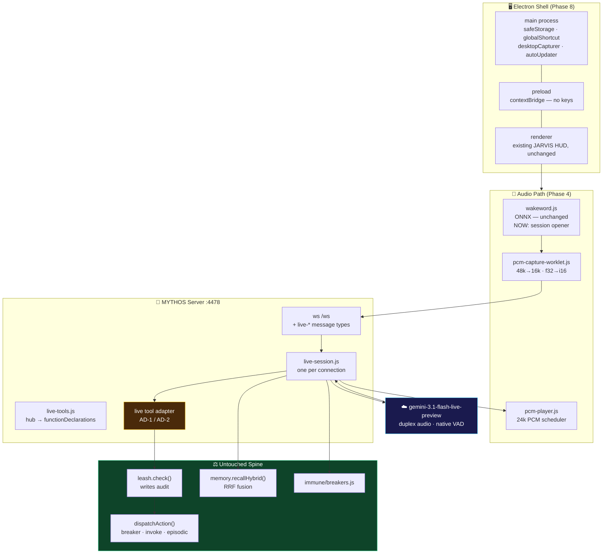
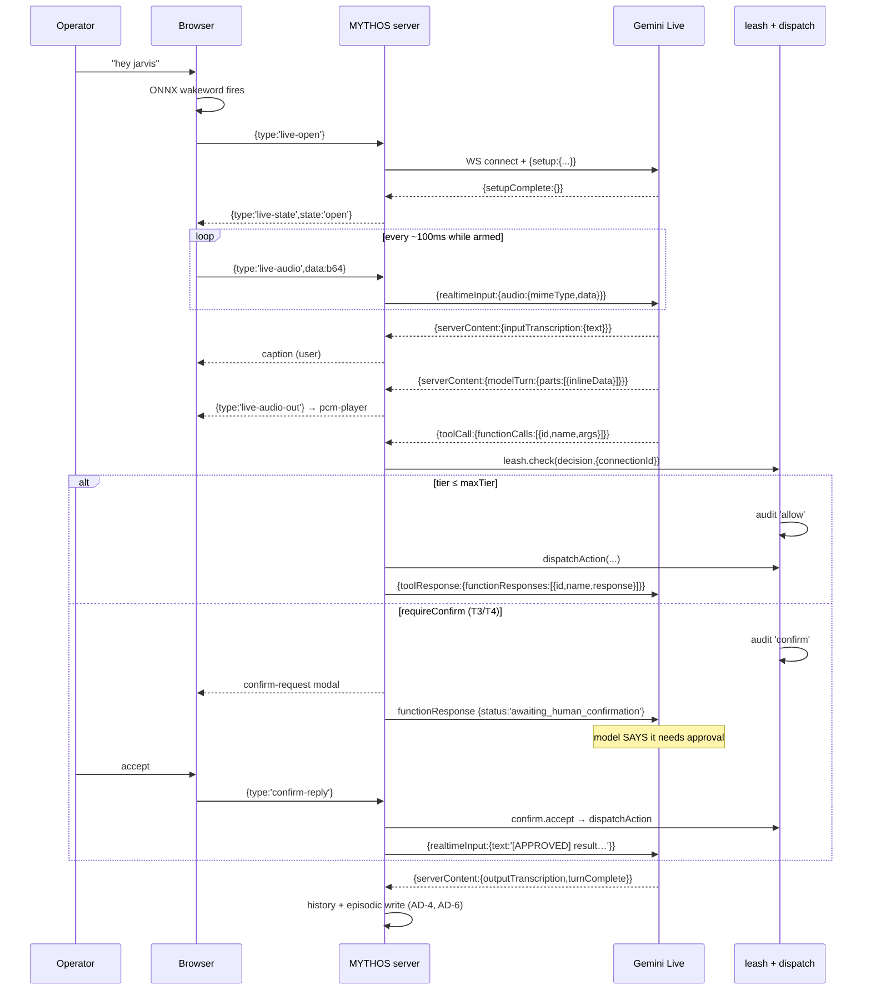
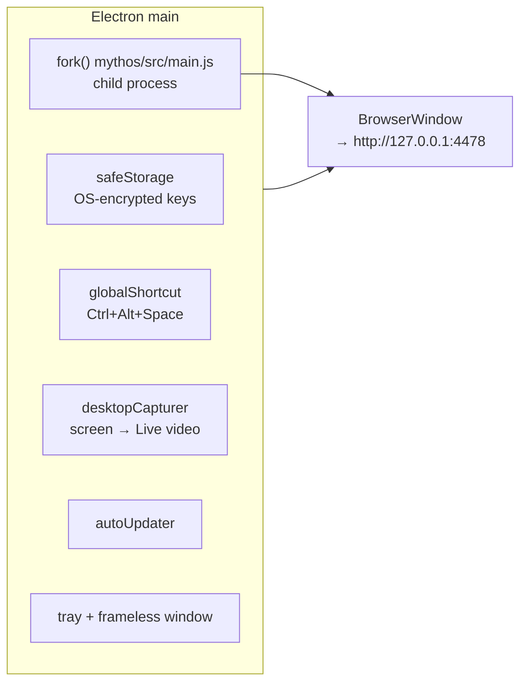

# MYTHOS × IRIS — Synthesis Plan

**Native speech-to-speech voice, Electron distribution shell, and the real capability gaps.**

Version 2. Every line number, field name, and function signature below was read out of the
actual files or the actual API reference during planning — nothing here is from memory.
Treat the two "FROZEN REFERENCE" sections as ground truth and re-verify anything else
before you build on it.

---

## 0. How to use this document

This is an execution contract, not a sketch. Read in this order:

1. **§1 Anti-Drift Contract** — the ten invariants. Every one has an executable check.
   Violating one is a build failure, not a style opinion.
2. **§2 Target architecture** — where the new pieces sit.
3. **§3 / §4 Frozen references** — the Gemini Live wire protocol and the exact MYTHOS seams.
   Do not re-derive these; do not paraphrase field names.
4. **§5–§13 Phases** — sequential. Each has a gate that must pass before the next starts.
5. **§14 Test matrix**, **§15 Agent handoff**, **§16 Rollback**.

**Prime directive, inherited from the repo and from what the comparison exposed:** IRIS ships
a HUD that displays `temperature = 40 + cpu*0.4 + Math.random()*2` and network stats that are
pure `Math.random()`. That is the single thing from IRIS we take *nothing* of. MYTHOS's
honest-inert principle is the differentiator; every feature added here must show `OFFLINE`
or `DEGRADED` rather than invent a plausible number.

---

## 1. Anti-Drift Contract

Ten invariants. Each gets a real test file. `node --test` must fail if any is broken.

| ID | Invariant | Executable check |
|---|---|---|
| **AD-1** | **One execution surface.** Every tool call — cortex, voice-agent, Live session, REST, confirm-accept — goes `leash.check()` → `dispatchAction()` → `sharedDispatch`. No channel gets its own path. | `test/anti-drift-single-dispatch.test.js`: read every file under `src/core/` + `server/`; assert `effectors.invoke(` appears **only** in `src/core/effectors/dispatch-action.js`. |
| **AD-2** | **Leash owns the audit write.** `leash.check()` already calls `writeAudit()` on every branch (allow/deny/confirm/dry-run). Callers must never write a second audit line for the same decision. | `test/anti-drift-audit-single-write.test.js`: stub `auditWriter.write`, drive one Live tool call end-to-end, assert exactly one write per `check()`. |
| **AD-3** | **Tool declarations derive from the hub.** Gemini `functionDeclarations` are generated from `buildCatalogFromHub(effectors)`. No hand-maintained parallel list. | `test/anti-drift-live-tools-subset.test.js`: assert every declared name ∈ `hub.catalog()` names, and that a fake newly-registered effector shows up automatically. |
| **AD-4** | **No fabricated success.** The model's spoken claim is reconciled against real tool outcomes before the turn is persisted. Live has no `needs_result` loop, so this must be enforced on `turnComplete`. | `test/anti-drift-live-no-fabrication.test.js`: force a tool to fail, assert the episodic record's `detail.actions[].ok === false` and that a `system`-role outcome note was appended to history. |
| **AD-5** | **No invented telemetry — the IRIS anti-pattern.** No status, health, metric, or HUD value may be synthesized. | `test/anti-drift-no-fake-telemetry.test.js`: grep `src/core/`, `server/`, `ui/public/js/` for `Math.random()` and fail on any hit inside a file whose path or symbol matches `stat|metric|health|telemetry|temperature|latency` (allowlist jitter/backoff sites explicitly by line). |
| **AD-6** | **S2S turns are never amnesiac.** Every completed Live turn writes both transcripts to episodic memory. A turn that completes with no transcript emits `health.anomaly`. | `test/live-session-transcripts.test.js`: feed a scripted server frame sequence, assert episodic write contains user + assistant text. |
| **AD-7** | **Portability.** No user-specific or machine-specific absolute path in any tracked file. Everything from `os.homedir()`/`process.env`/`%~dp0`. | Extend the existing convention with `test/anti-drift-no-absolute-paths.test.js`: fail on `/^[A-Za-z]:\\\\Users\\\\/` or `/home/[a-z]/` in tracked source. |
| **AD-8** | **Secrets never reach the renderer.** The Live API key lives server-side only. When the Electron shell lands (§13), the preload `contextBridge` exposes no key-reading channel. | `test/anti-drift-no-key-to-client.test.js`: assert no WS OUT message type and no `/api/*` response body ever contains a value matching `GOOGLE_API_KEY`/`GROQ_API_KEY`/etc. |
| **AD-9** | **Optional binaries degrade, they never crash boot.** `adb`, `cua-driver`, Chrome, edge-tts: spawn ENOENT → adapter OFFLINE. Hermes remains the single deliberate exception (builds FAIL with an install hint rather than shipping a wrong artifact). | `test/anti-drift-optional-binaries.test.js`: force ENOENT on each adapter, assert boot completes and status reports OFFLINE. |
| **AD-10** | **Docs match reality.** Test count, tool count, provider count, sensor count in README/CLAUDE.md are generated, never hand-typed. | Extend `mythos/scripts/sync-test-count.js` to also emit tool/provider/sensor counts from `hub.catalog()` and directory reads; `--check` gates CI and the pre-commit hook. |

**Drift log.** Add `mythos/docs/DRIFT-LOG.md`. Any time an invariant is deliberately bent,
one line: date, invariant, reason, expiry. An entry with no expiry is a bug.

---

## 2. Target architecture



**Turn flow, S2S:**



---

## 3. FROZEN REFERENCE — Gemini Live wire protocol

Verified against `ai.google.dev/api/live`, `ai.google.dev/gemini-api/docs/live-guide`, and
Google's own `gemini-live-api-dev` skill. **Do not paraphrase these field names.**

**Endpoint**
```
wss://generativelanguage.googleapis.com/ws/google.ai.generativelanguage.v1beta.GenerativeService.BidiGenerateContent?key=<GOOGLE_API_KEY>
```

**Model:** `gemini-3.1-flash-live-preview` — Google's recommended Live model, native audio
out, 128k context. Secondary: `gemini-2.5-flash-native-audio-preview-12-2025`.

**Audio:** input raw PCM, **little-endian, 16-bit, mono, 16 kHz**, mimeType
`audio/pcm;rate=16000`. Output **24 kHz** PCM.

**Client → server envelopes** (exactly one top-level key per frame):

| Frame | Shape |
|---|---|
| `setup` | `{model, generationConfig:{responseModalities:["AUDIO"], speechConfig:{voiceConfig:{prebuiltVoiceConfig:{voiceName}}}, temperature}, systemInstruction, tools:[{functionDeclarations:[…]}], realtimeInputConfig:{automaticActivityDetection:{}}, inputAudioTranscription:{}, outputAudioTranscription:{}, sessionResumption:{handle}, contextWindowCompression:{slidingWindow:{}}}` |
| `realtimeInput` | `{audio:{mimeType:"audio/pcm;rate=16000", data:"<b64>"}}` — also accepts `{text}`, `{video}`, `{activityStart}`, `{activityEnd}`, `{audioStreamEnd:true}` |
| `toolResponse` | `{functionResponses:[{id, name, response:{…}}]}` |
| `clientContent` | seeding initial history only — **never** for live user speech |

**Server → client envelopes:**

| Frame | Shape |
|---|---|
| `setupComplete` | `{}` |
| `serverContent` | `{modelTurn:{parts:[{inlineData:{mimeType,data}}]}, inputTranscription:{text}, outputTranscription:{text}, interrupted:bool, turnComplete:bool, generationComplete:bool}` |
| `toolCall` | `{functionCalls:[{id, name, args}]}` |
| `toolCallCancellation` | `{ids:[…]}` |
| `goAway` | `{timeLeft}` — connection about to close |
| `sessionResumptionUpdate` | `{newHandle, resumable}` |
| `usageMetadata` | `{promptTokenCount, cachedContentTokenCount, responseTokenCount, totalTokenCount}` |

**Two hard rules from Google's own guidance:**
1. Use `realtimeInput` for user turns. `clientContent` mid-conversation breaks VAD.
2. **A single `serverContent` frame may carry audio *and* transcripts simultaneously —
   process every field present, do not `else if`.** This is the #1 data-loss bug.

**Limits:** ~15 min audio-only session without compression; overall connection lifetime
~10 min. Therefore `contextWindowCompression.slidingWindow` and `sessionResumption` are
**mandatory**, not optional.

---

## 4. FROZEN REFERENCE — MYTHOS seams

Read from the real files. Line numbers as of planning; re-confirm with a `git pull` first
(per CLAUDE.md's concurrent-session rule) before editing any of these.

| Seam | Location | Exact contract |
|---|---|---|
| WS connection | [server/index.js:662](mythos/server/index.js#L662) | `wss.on('connection', ws => {…})`, `const connectionId = crypto.randomUUID()` at :663 |
| WS inbound router | [server/index.js:1145](mythos/server/index.js#L1145) | `ws.on('message')` → `if (msg.type === 'utterance') … else if …`. Add `live-*` branches here. |
| WS send helper | [server/index.js:725](mythos/server/index.js#L725) | `function send(msg) { if (ws.readyState === ws.OPEN) ws.send(JSON.stringify(msg)); }` |
| Turn serializer | [server/index.js:700](mythos/server/index.js#L700) | `queueTurn(fn)` — per-connection promise chain |
| History | [server/index.js:1074-1122](mythos/server/index.js#L1074) | `historyGet()`, `historyAppend(role, content)`; SERVER-scoped (not per-connection — a WS reconnect used to wipe it), 40 entries bounded by a 12000-char total budget, 2000 chars per entry, 45-min idle TTL, persisted to `vault/Conversation/session.json` and restored when younger than the TTL. Roles `user`/`assistant`/`system` (system = action outcomes). |
| Dispatch | [server/index.js:464](mythos/server/index.js#L464) | `dispatchAction(decision, ctx)` → `sharedDispatch(decision, {effectors,bus,goals,memory,config,goalId,tier,channel,traceId})`. Returns `{ok, result}`; `{ok:false, result:'circuit-open'}` when the breaker is open. |
| Leash gate | [leash/index.js:105](mythos/src/core/leash/index.js#L105) | `check(action, goalCtx)` → `{allow, requireConfirm, tier, reason}`. **Writes its own audit line on every branch.** `goalCtx = {goalId, connectionId}`. |
| Confirm registry | [leash/confirm.js:87](mythos/src/core/leash/confirm.js#L87) | `create(summary, action, connectionId)` → id; `accept(confirmId, connectionId)` → the stored action envelope `{decision, goalId, tier}`; `reject`, `peek`, `peekTier`, `stats` |
| Confirm-accept path | [server/index.js:1088-1105](mythos/server/index.js#L1088) | `leash.confirm.accept()` → `dispatchAction(decision, {goalId, tier, channel:'confirm-accept', traceId:confirmId})` |
| Session grants | [leash/index.js:59](mythos/src/core/leash/index.js#L59) | `SESSION_GRANTABLE = {ui_click, ui_type, click_at, send_key, focus_window}`, 15-min TTL, keyed `connectionId:tool`. Do **not** widen. |
| Tool catalog | [voice-agent.js:121](mythos/src/core/voice/voice-agent.js#L121) | `buildCatalogFromHub(hub)` → `[{name, description, params, danger, needs_result}]`. Exported. |
| Memory recall | [server/index.js:1381](mythos/server/index.js#L1381) | `memory.recallHybrid(text, {limit:12, windowDays:21, excludeKinds:['proactive-speech']})` wrapped in `recallWithTimeout(…, RECALL_TIMEOUT_MS)` |
| Episodic write | [server/index.js:918](mythos/server/index.js#L918) | `memory.episodic.write({kind, tick, summary, detail, salience, channel})` |
| Persona compose | [brain/index.js:117-134](mythos/src/core/brain/index.js#L117) | lanes `['voice','build','simple']` get `{role:'system', content: personaLine}` prepended; `' Be concise and actionable.'` hardcoded at :124, :126, :128 |
| Persona dials | [identity/index.js:52](mythos/src/core/identity/index.js#L52) | `{humor:8, warmth:7, formality:5, sass:7, proactivity:8, terseness:5, strictness:4}` (2026-07-30 unclamp; terseness deliberately stays 5 — see the comment there), persisted at `vault/Identity/persona.json`; bands in `styleDirectives()`; `STYLE_GUARDRAIL` after it. `persona()` also folds in the newest 10 learned preferences, `Identity/operator-style.txt`, and the durable `Identity/operator-profile.txt`. |
| Spend | [brain/spend.js](mythos/src/core/brain/spend.js) | `spend.recordCall({provider, model, source, ok, inputTokens, outputTokens})` |
| Breakers | [immune/breakers.js](mythos/src/core/immune/breakers.js) | `effectors.breakers.allow(name)`; CLOSED→OPEN→HALF_OPEN |
| WS auth hook | [server/index.js:357,369](mythos/server/index.js#L357) | `verifyClient(info, callback)`; `new WebSocketServer({server, path:'/ws', verifyClient})` |
| Bind default | [config/schema.js:13](mythos/src/core/config/schema.js#L13) | `MYTHOS_BIND` default `127.0.0.1` |
| PC daemon | [adapters/pc-child/index.js](mythos/adapters/pc-child/index.js) | JSON-over-stdin, every command carries `id`, echoed back; 15s timeout; mismatched ids dropped as stale |
| WinRT helper | `adapters/pc-child/ps-automation.ps1` | `Await-WinRTOperation` with explicit `[type]$ResultType`. **Never** name a parameter `$pid`. `Write-Response` escapes non-ASCII as `\uXXXX` and echoes the command id. |

---

## 5. Phase 0 — Proof of access + clean baseline

**Gate: nothing in Phases 1–5 starts until all three pass.**

### 0.1 Green the suite

Real baseline is **1,511 tests / 1,508 pass / 2 fail / 1 skip** — not the 1,197 in
`CLAUDE.md`, not the 1,329 in README. Two genuine failures:
`test/ps-dispatch-honest-failure.test.js`, `test/spotify-effector.test.js`.

Use `superpowers:systematic-debugging`. **Do not** relax assertions to go green — both
tests are named after honesty guarantees, which makes them exactly the tests you must not
weaken. If host memory exhaustion shows up (exit 127, no summary, failures wandering
between files), count stray `node.exe` first — that's a known false alarm in this repo.

### 0.2 Kill doc drift, then automate it

```bash
cd mythos && node scripts/sync-test-count.js --write
```
Then correct the verified-wrong README claims: deps **4→7** (`@mediapipe/tasks-vision`,
`exceljs`, `express`, `onnxruntime-web`, `playwright-core`, `pptxgenjs`, `ws`), effectors
**45→106**, providers **6→12**, sensors **5→10**. Replace the stale "Latest session update"
block in `CLAUDE.md`. Then implement AD-10 so these numbers can never rot again.

### 0.3 Prove Live access — the hard blocker ✅ PASSED 2026-07-30

**RESULT: `models/gemini-3.1-flash-live-preview` → PASS.** 84,482 bytes of real 24 kHz
audio returned, transcript "Hello, nice to meet you.", clean `turnComplete`. Phases 1–5 are
unblocked. Script shipped at `mythos/scripts/verify-gemini-live.js` (it self-loads
`mythos/.env` via `process.loadEnvFile`, since standalone scripts don't get main.js's env
loading, and it walks three candidate models in preference order).

Original rationale, kept for the record:
`lanes.default.js:33` records that free Google keys return 429 on every Pro-tier Gemini.
Live may be gated the same way. **Find out in an hour, not a week.**

`mythos/scripts/verify-gemini-live.js`:

```js
'use strict';
// verify-gemini-live.js — does THIS key actually have Live API access?
// Read-only probe. Prints a real audio byte count or an honest failure.
// Run: node scripts/verify-gemini-live.js
const WebSocket = require('ws');

const KEY = process.env.GOOGLE_API_KEY;
if (!KEY) { console.error('FAIL: GOOGLE_API_KEY unset'); process.exit(2); }

const MODELS = [
  'models/gemini-3.1-flash-live-preview',
  'models/gemini-2.5-flash-native-audio-preview-12-2025',
];
const URL = 'wss://generativelanguage.googleapis.com/ws/' +
  'google.ai.generativelanguage.v1beta.GenerativeService.BidiGenerateContent?key=' + KEY;

// 1s of 16kHz mono 440Hz tone — a real signal, not silence (silence + VAD = no reply).
function tone(ms = 1000, rate = 16000, hz = 440) {
  const n = Math.floor(rate * ms / 1000);
  const buf = Buffer.alloc(n * 2);
  for (let i = 0; i < n; i++) {
    buf.writeInt16LE(Math.round(Math.sin(2 * Math.PI * hz * i / rate) * 12000), i * 2);
  }
  return buf.toString('base64');
}

function probe(model) {
  return new Promise((resolve) => {
    const ws = new WebSocket(URL);
    let audioBytes = 0, transcript = '', setupOk = false;
    const done = (verdict, detail) => {
      try { ws.close(); } catch {}
      resolve({ model, verdict, detail, audioBytes, transcript });
    };
    const timer = setTimeout(() => done(setupOk ? 'NO_AUDIO' : 'NO_SETUP', 'timeout 20s'), 20000);

    ws.on('open', () => {
      ws.send(JSON.stringify({ setup: {
        model,
        generationConfig: { responseModalities: ['AUDIO'] },
        systemInstruction: { parts: [{ text: 'Reply with one short spoken sentence.' }] },
        inputAudioTranscription: {},
        outputAudioTranscription: {},
      }}));
    });

    ws.on('message', (raw) => {
      let m; try { m = JSON.parse(raw.toString()); } catch { return; }
      if (m.setupComplete) {
        setupOk = true;
        ws.send(JSON.stringify({ realtimeInput: {
          audio: { mimeType: 'audio/pcm;rate=16000', data: tone() },
        }}));
        // Nudge: a tone may not trip VAD as speech. Text proves the round trip.
        ws.send(JSON.stringify({ realtimeInput: { text: 'Say hello in one sentence.' } }));
        return;
      }
      const sc = m.serverContent;
      if (sc) {
        // NOT else-if — one frame can carry audio AND transcripts (see §3).
        const parts = (sc.modelTurn && sc.modelTurn.parts) || [];
        for (const p of parts) {
          if (p.inlineData && p.inlineData.data) {
            audioBytes += Buffer.from(p.inlineData.data, 'base64').length;
          }
        }
        if (sc.outputTranscription && sc.outputTranscription.text) transcript += sc.outputTranscription.text;
        if (sc.turnComplete) { clearTimeout(timer); return done(audioBytes > 0 ? 'PASS' : 'NO_AUDIO', 'turnComplete'); }
      }
      if (m.goAway) { clearTimeout(timer); return done('GOAWAY', JSON.stringify(m.goAway)); }
    });

    ws.on('error', (e) => { clearTimeout(timer); done('ERROR', e.message); });
    ws.on('close', (code, reason) => {
      clearTimeout(timer);
      if (audioBytes === 0) done(setupOk ? 'CLOSED_NO_AUDIO' : 'REJECTED', `code=${code} ${reason}`);
    });
  });
}

(async () => {
  for (const m of MODELS) {
    const r = await probe(m);
    console.log(`${r.verdict.padEnd(16)} ${r.model}  audio=${r.audioBytes}B  "${r.transcript.slice(0,60)}"  ${r.detail||''}`);
    if (r.verdict === 'PASS') {
      console.log(`\nUSE THIS: GEMINI_LIVE_MODEL=${r.model}`);
      process.exit(0);
    }
  }
  console.error('\nFAIL: no Live-capable model on this key.');
  console.error('Phases 1-5 are BLOCKED. Phase 6 (persona) and Phase 7 (capabilities) still apply.');
  process.exit(1);
})();
```

**If this exits non-zero: stop and report it.** Do not build a bridge to an API the key
can't reach. Phases 6 and 7 remain fully valuable on their own — the persona work is the
single biggest felt improvement and needs no new transport.

---

## 6. Phase 1 — `live-session.js`, the server-side bridge

**New file: `mythos/src/core/voice/live-session.js`**

Design decisions, each load-bearing:

- **Server-side socket.** The key never reaches the browser (AD-8), and tool calls land
  where `leash`/`dispatch`/`breakers`/`auditWriter` already live (AD-1).
- **One session per WS connection**, created lazily on wake word (cost gate), never at boot.
- **Both transcriptions on.** Non-negotiable — without them MYTHOS is amnesiac and
  unauditable (AD-6).
- **`contextWindowCompression` + `sessionResumption` from day one**, because the connection
  dies at ~10 min regardless.

```js
'use strict';
// live-session.js — Gemini Live (BidiGenerateContent) bridge. One per WS connection.
//
// WIRE PROTOCOL IS FROZEN — see the plan's §3. Client frames have exactly one
// top-level key: setup | realtimeInput | toolResponse | clientContent.
// Server frames: setupComplete | serverContent | toolCall | toolCallCancellation
// | goAway | sessionResumptionUpdate | usageMetadata.
//
// CRITICAL: a single serverContent frame may carry audio AND inputTranscription AND
// outputTranscription AND turnComplete. Handle every field present — never else-if.
// That mistake silently drops transcripts and breaks AD-6.
//
// This module owns TRANSPORT ONLY. Tool execution is delegated to the injected
// onToolCall() so the leash/dispatch spine stays the single execution surface (AD-1).

const WebSocket = require('ws');

const WS_URL = 'wss://generativelanguage.googleapis.com/ws/' +
  'google.ai.generativelanguage.v1beta.GenerativeService.BidiGenerateContent';

function createLiveSession(deps) {
  const {
    config, bus, logger, spend, breakers,
    systemInstruction,      // string — full RULES + persona (Phase 6)
    functionDeclarations,   // [] from live-tools.js (Phase 2)
    onToolCall,             // async (calls[], {sendToolResponse}) => void  (Phase 3)
    onAudioOut,             // (base64Pcm24k) => void
    onTranscript,           // ({role:'user'|'assistant', text, final}) => void
    onState,                // ({state, reason}) => void
    onTurnComplete,         // ({userText, assistantText}) => void
  } = deps;

  const MODEL = config.GEMINI_LIVE_MODEL || 'models/gemini-3.1-flash-live-preview';
  const VOICE = config.GEMINI_LIVE_VOICE || 'Aoede';
  const IDLE_MS = Number(config.LIVE_IDLE_TIMEOUT_MS) || 45000;
  const MAX_MS = Number(config.LIVE_SESSION_MAX_MS) || 10 * 60 * 1000;
  const BREAKER = 'gemini-live';

  let ws = null;
  let state = 'closed';          // closed | opening | open | reconnecting
  let resumeHandle = null;       // from sessionResumptionUpdate
  let idleTimer = null, maxTimer = null;
  let userText = '', assistantText = '';
  let closedByUs = false;

  function setState(next, reason) {
    if (state === next) return;
    state = next;
    if (onState) onState({ state, reason: reason || null });
    bus.emit('voice.live.state', { state, reason: reason || null });
  }

  function armIdle() {
    if (idleTimer) clearTimeout(idleTimer);
    idleTimer = setTimeout(() => close('idle-timeout'), IDLE_MS);
    if (idleTimer.unref) idleTimer.unref();
  }

  function sendRaw(frame) {
    if (!ws || ws.readyState !== ws.OPEN) return false;
    try { ws.send(JSON.stringify(frame)); return true; }
    catch (err) { logger.warn('live.send-failed', { error: err.message }); return false; }
  }

  function buildSetup() {
    const setup = {
      model: MODEL,
      generationConfig: {
        responseModalities: ['AUDIO'],
        speechConfig: { voiceConfig: { prebuiltVoiceConfig: { voiceName: VOICE } } },
      },
      systemInstruction: { parts: [{ text: systemInstruction }] },
      tools: functionDeclarations.length ? [{ functionDeclarations }] : undefined,
      realtimeInputConfig: { automaticActivityDetection: {} },
      inputAudioTranscription: {},   // AD-6
      outputAudioTranscription: {},  // AD-6
      // Session dies at ~10min and ~15min of audio without these. Not optional.
      contextWindowCompression: { slidingWindow: {} },
      sessionResumption: resumeHandle ? { handle: resumeHandle } : {},
    };
    if (!setup.tools) delete setup.tools;
    return setup;
  }

  async function open() {
    if (state === 'open' || state === 'opening') return true;
    if (breakers && typeof breakers.allow === 'function' && !breakers.allow(BREAKER)) {
      setState('closed', 'breaker-open');
      return false;
    }
    const key = process.env.GOOGLE_API_KEY;
    if (!key) { setState('closed', 'no-key'); return false; }

    setState('opening');
    closedByUs = false;
    return new Promise((resolve) => {
      let settled = false;
      try { ws = new WebSocket(`${WS_URL}?key=${key}`); }
      catch (err) { setState('closed', err.message); return resolve(false); }

      ws.on('open', () => sendRaw({ setup: buildSetup() }));
      ws.on('message', (raw) => {
        let msg; try { msg = JSON.parse(raw.toString()); } catch { return; }
        if (msg.setupComplete && !settled) {
          settled = true;
          setState('open');
          armIdle();
          maxTimer = setTimeout(() => close('session-max'), MAX_MS);
          if (maxTimer.unref) maxTimer.unref();
          resolve(true);
        }
        handleFrame(msg);
      });
      ws.on('error', (err) => {
        if (breakers && typeof breakers.fail === 'function') breakers.fail(BREAKER);
        logger.warn('live.ws-error', { error: err.message });
        setState('closed', err.message);
        if (!settled) { settled = true; resolve(false); }
      });
      ws.on('close', (code, reason) => {
        const why = `code=${code} ${String(reason || '')}`.trim();
        if (!settled) { settled = true; setState('closed', why); return resolve(false); }
        // Unexpected mid-session drop with a resume handle → transparent reconnect,
        // treated as a breaker event, never a crash.
        if (!closedByUs && resumeHandle) { setState('reconnecting', why); reconnect(); }
        else setState('closed', why);
      });
    });
  }

  async function reconnect() {
    if (breakers && typeof breakers.fail === 'function') breakers.fail(BREAKER);
    const ok = await open();
    if (!ok) bus.emit('health.anomaly', { kind: 'live-reconnect-failed', reason: 'session-resume' });
  }

  function handleFrame(msg) {
    // ---- serverContent: EVERY field, no else-if (see module header) ----
    const sc = msg.serverContent;
    if (sc) {
      if (sc.inputTranscription && sc.inputTranscription.text) {
        userText += sc.inputTranscription.text;
        if (onTranscript) onTranscript({ role: 'user', text: sc.inputTranscription.text, final: false });
        armIdle();
      }
      if (sc.outputTranscription && sc.outputTranscription.text) {
        assistantText += sc.outputTranscription.text;
        if (onTranscript) onTranscript({ role: 'assistant', text: sc.outputTranscription.text, final: false });
      }
      const parts = (sc.modelTurn && sc.modelTurn.parts) || [];
      for (const p of parts) {
        if (p.inlineData && p.inlineData.data && onAudioOut) onAudioOut(p.inlineData.data);
        if (p.text && onTranscript) onTranscript({ role: 'assistant', text: p.text, final: false });
      }
      if (sc.interrupted) bus.emit('voice.live.interrupted', {});
      if (sc.turnComplete) {
        if (breakers && typeof breakers.success === 'function') breakers.success(BREAKER);
        const turn = { userText: userText.trim(), assistantText: assistantText.trim() };
        userText = ''; assistantText = '';
        if (!turn.userText && !turn.assistantText) {
          // AD-6: a completed turn with no transcript means the entity went blind.
          bus.emit('health.anomaly', { kind: 'live-turn-no-transcript' });
        }
        if (onTurnComplete) onTurnComplete(turn);
        armIdle();
      }
    }

    // ---- tool calls → delegated, never executed here (AD-1) ----
    if (msg.toolCall && Array.isArray(msg.toolCall.functionCalls) && onToolCall) {
      armIdle();
      Promise.resolve(onToolCall(msg.toolCall.functionCalls, { sendToolResponse, sendText }))
        .catch((err) => logger.warn('live.toolcall-failed', { error: err.message }));
    }
    if (msg.toolCallCancellation) {
      bus.emit('voice.live.toolcancel', { ids: msg.toolCallCancellation.ids || [] });
    }

    // ---- lifecycle ----
    if (msg.sessionResumptionUpdate) {
      if (msg.sessionResumptionUpdate.resumable && msg.sessionResumptionUpdate.newHandle) {
        resumeHandle = msg.sessionResumptionUpdate.newHandle;
      }
    }
    if (msg.goAway) {
      // Server is about to hang up. Reconnect proactively so the operator hears no seam.
      logger.info('live.goaway', { timeLeft: msg.goAway.timeLeft });
      setState('reconnecting', 'goaway');
      try { closedByUs = true; ws.close(); } catch {}
      closedByUs = false;
      reconnect();
    }
    if (msg.usageMetadata && spend && typeof spend.recordCall === 'function') {
      // Honest spend: real counts from the API, never estimated (AD-5).
      spend.recordCall({
        provider: 'google-live', model: MODEL, source: 'voice-live', ok: true,
        inputTokens: Number(msg.usageMetadata.promptTokenCount) || 0,
        outputTokens: Number(msg.usageMetadata.responseTokenCount) || 0,
      });
    }
  }

  function sendAudio(base64Pcm16k) {
    if (state !== 'open') return false;
    armIdle();
    return sendRaw({ realtimeInput: { audio: { mimeType: 'audio/pcm;rate=16000', data: base64Pcm16k } } });
  }

  // Text injection on the realtimeInput channel (NOT clientContent — that breaks VAD
  // mid-conversation per Google's guidance). Used for the post-confirm follow-up.
  function sendText(text) {
    if (state !== 'open') return false;
    return sendRaw({ realtimeInput: { text: String(text) } });
  }

  function sendToolResponse(functionResponses) {
    return sendRaw({ toolResponse: { functionResponses } });
  }

  function close(reason) {
    closedByUs = true;
    if (idleTimer) clearTimeout(idleTimer);
    if (maxTimer) clearTimeout(maxTimer);
    if (ws) { try { ws.close(); } catch {} }
    ws = null;
    setState('closed', reason || 'closed');
  }

  return { open, close, sendAudio, sendText, sendToolResponse,
           getState: () => state, isOpen: () => state === 'open' };
}

module.exports = { createLiveSession, _internal: { WS_URL } };
```

**Config additions** — `src/core/config/schema.js` + `.env.example`, following the
`SCREEN_AWARENESS_ENABLED` precedent (opt-in, default off):

```
# Native speech-to-speech (Gemini Live). Opt-in — default false.
# VOICE_S2S_ENABLED=false
# GEMINI_LIVE_MODEL=models/gemini-3.1-flash-live-preview
# GEMINI_LIVE_VOICE=Aoede          # Aoede | Kore | Leda | Zephyr | Puck | Charon
# LIVE_IDLE_TIMEOUT_MS=45000       # close socket after this much silence (cost gate)
# LIVE_SESSION_MAX_MS=600000       # hard wall-clock cap per session
# LIVE_TOOL_ALLOWLIST=             # comma-separated; empty = curated default set
```

**Cost control is a requirement, not a nicety.** Continuous duplex audio bills for open-mic
time; today's model bills per utterance. The gate is three-layered: socket opens only on
wake word or PTT, `LIVE_IDLE_TIMEOUT_MS` closes it on silence, `LIVE_SESSION_MAX_MS` caps
wall clock. Real `usageMetadata` flows into the existing spend widget so the number on
screen is the number Google charged.

---

## 7. Phase 2 — `live-tools.js`, hub → `functionDeclarations`

**New file: `mythos/src/core/voice/live-tools.js`**

The hazard: MYTHOS's `params` are prose strings — `'string (optional)'`,
`'number (optional) - exact target 0-100'`, `"'approve' | 'reject'"`. Gemini needs real
JSON Schema. This converter is where bugs hide, so it gets its own test file.

```js
'use strict';
// live-tools.js — convert MYTHOS's effector catalog into Gemini functionDeclarations.
//
// AD-3: declarations derive from buildCatalogFromHub(hub) — the real registry — so a
// newly-registered effector reaches the Live channel with zero manual duplication.
// Never hand-maintain a parallel list here.
//
// Nothing is ever silently dropped: an unparseable param becomes a string with its
// original prose as the description. A dropped param is a tool that fails at runtime
// for reasons nobody can see.

const { buildCatalogFromHub } = require('./voice-agent');

// Function-calling accuracy degrades with very large tool sets, and MYTHOS registers 106.
// This is the curated high-traffic default; override with LIVE_TOOL_ALLOWLIST.
const DEFAULT_ALLOWLIST = [
  'navigate','close_panel','read_status','open_web',
  'create_goal','list_goals','toggle_goal','delete_goal',
  'capture_idea','pipeline_status','pipeline_advance',
  'kanban_status','kanban_add_card','kanban_move_card',
  'start_project','build_project','project_status','job_status','open_artifact',
  'get_time','get_weather','web_search','web_fetch',
  'remember','log_incident','recall_memory',
  'reminder_add','reminder_list','reminder_cancel',
  'gmail_unread','gmail_read','gmail_draft','gmail_send',
  'spotify_play','spotify_play_pause','spotify_next','spotify_volume','spotify_status',
  'media_status','launch_app','focus_window','list_windows','ui_click','ui_type','send_key',
  'screen_look','screen_read_text','capture_screenshot',
  'browser_navigate','browser_click','browser_type','browser_get_text',
  'set_persona_level','ask_agent',
];

const OPTIONAL_RE = /\(optional\)/i;
const TYPE_RE = /^\s*(string|number|integer|boolean|object|array)\b/i;
const ENUM_RE = /'([^']+)'/g;

// 'number (optional) - exact target 0-100'  ->  {type:'number', description:'exact target 0-100'}
// "'approve' | 'reject'"                    ->  {type:'string', enum:['approve','reject']}
function parseParam(name, spec) {
  const raw = String(spec == null ? '' : spec);
  const optional = OPTIONAL_RE.test(raw);
  const typeMatch = raw.match(TYPE_RE);
  let type = typeMatch ? typeMatch[1].toLowerCase() : 'string';
  if (type === 'integer') type = 'number'; // Gemini schema uses NUMBER/INTEGER; NUMBER is safe

  const enumVals = [];
  let m;
  const enumRe = new RegExp(ENUM_RE.source, 'g');
  while ((m = enumRe.exec(raw)) !== null) enumVals.push(m[1]);

  // Description = the prose minus the type token and the (optional) marker.
  const description = raw
    .replace(TYPE_RE, '')
    .replace(OPTIONAL_RE, '')
    .replace(/^[\s\-—:|]+/, '')
    .trim() || name;

  const schema = { type, description };
  // Only treat quoted tokens as an enum when they look like a closed set, not prose.
  if (enumVals.length >= 2 && enumVals.every((v) => v.length <= 24)) schema.enum = enumVals;
  return { schema, optional };
}

function toDeclaration(entry) {
  const properties = {};
  const required = [];
  const params = entry.params || {};
  for (const key of Object.keys(params)) {
    const { schema, optional } = parseParam(key, params[key]);
    properties[key] = schema;
    if (!optional) required.push(key);
  }
  const decl = {
    name: entry.name,
    description: String(entry.description || entry.name).slice(0, 1024),
  };
  if (Object.keys(properties).length) {
    decl.parameters = { type: 'object', properties };
    if (required.length) decl.parameters.required = required;
  }
  return decl;
}

function buildFunctionDeclarations(hub, opts) {
  const options = opts || {};
  const catalog = buildCatalogFromHub(hub);
  const allow = options.allowlist && options.allowlist.length
    ? new Set(options.allowlist)
    : new Set(DEFAULT_ALLOWLIST);

  const declared = [], withheld = [];
  for (const entry of catalog) {
    if (!entry || !entry.name) continue;
    if (allow.has(entry.name)) declared.push(toDeclaration(entry));
    else withheld.push(entry.name);
  }
  // AD-5 in spirit: a silent cap reads as full coverage. Say what was withheld.
  if (options.log && withheld.length) {
    options.log(`live-tools: declared ${declared.length}, withheld ${withheld.length} — ${withheld.join(', ')}`);
  }
  return { declarations: declared, withheld };
}

module.exports = { buildFunctionDeclarations, DEFAULT_ALLOWLIST, _internal: { parseParam, toDeclaration } };
```

`test/live-tools.test.js` must cover: `'string (optional)'` → not required;
`'number (optional) - exact target 0-100'` → `{type:'number'}` with clean description;
`"'approve' | 'reject'"` → enum; a param with unparseable prose → `string` with prose
preserved; a hub entry absent from the allowlist → reported in `withheld`, never dropped
silently; and AD-3's subset property.

---

## 8. Phase 3 — the tool adapter (the safety seam)

This is the only place where the new transport touches safety, and it is an **adapter**,
not a reimplementation. Roughly 60 lines, all of it delegation.

Add inside `wss.on('connection')` in `server/index.js`, alongside `handleUtterance`:

```js
    // ---- Live tool-call adapter (Phase 3) --------------------------------
    // AD-1: identical gate → dispatch path as voice-agent.executeAction() and
    // handleConfirmReply(). AD-2: leash.check() writes the audit line; we never do.
    //
    // Deferred-confirm design: Gemini expects a functionResponse promptly, and a T3
    // confirm can sit for 30s. So we answer IMMEDIATELY with awaiting_human_confirmation
    // (which makes the model SAY it needs approval — good behaviour, not a workaround),
    // and inject the real outcome later as a realtimeInput text turn once the human
    // accepts via the existing confirm modal.
    const livePendingConfirms = new Map(); // confirmId -> {name, callId}
    const liveTurnActions = [];            // AD-4: reconciled on turnComplete

    async function handleLiveToolCalls(calls, { sendToolResponse, sendText }) {
      const responses = [];
      for (const call of calls) {
        const decision = { tool: call.name, args: call.args || {} };
        let verdict;
        try {
          verdict = leash.check(decision, { connectionId, goalId: null });
        } catch (err) {
          logger.warn('live.leash-threw', { tool: call.name, error: err.message });
          responses.push({ id: call.id, name: call.name, response: { status: 'error', error: 'gate failure' } });
          continue;
        }

        if (verdict.requireConfirm) {
          const summary = `Voice: ${decision.tool}` +
            (Object.keys(decision.args).length ? ` (${humanizeLiveArgs(decision.args)})` : '');
          const confirmId = leash.confirm.create(
            summary, { decision, goalId: null, tier: verdict.tier }, connectionId);
          livePendingConfirms.set(confirmId, { name: call.name, callId: call.id });
          bus.emit('confirm-request', { ...decision, confirmId, summary, tier: verdict.tier });
          liveTurnActions.push({ tool: call.name, ok: false, confirmPending: true, summary });
          responses.push({ id: call.id, name: call.name, response: {
            status: 'awaiting_human_confirmation',
            message: `Tier ${verdict.tier} action. Tell the operator you need approval, then wait.`,
          }});
          continue;
        }

        if (!verdict.allow) {
          liveTurnActions.push({ tool: call.name, ok: false, summary: `Denied: ${verdict.reason}` });
          responses.push({ id: call.id, name: call.name, response: { status: 'denied', reason: verdict.reason } });
          continue;
        }

        try {
          const outcome = await dispatchAction(decision, {
            tier: verdict.tier, channel: 'voice-live', traceId: call.id,
          });
          const ok = Boolean(outcome && outcome.ok);
          const result = outcome && outcome.result;
          liveTurnActions.push({ tool: call.name, ok,
            summary: ok ? `${call.name} done.` : String((result && result.error) || result || 'Failed.').slice(0, 200) });
          responses.push({ id: call.id, name: call.name, response: ok
            ? { status: 'ok', result: truncateForModel(result) }
            : { status: 'failed', error: String((result && result.error) || result || 'Failed.').slice(0, 500) } });
        } catch (err) {
          liveTurnActions.push({ tool: call.name, ok: false, summary: err.message });
          responses.push({ id: call.id, name: call.name, response: { status: 'error', error: sanitizeErrorForClient(err) } });
        }
      }
      if (responses.length) sendToolResponse(responses);
    }

    // Hook the EXISTING confirm-accept path so an approval feeds the Live session.
    // Wire this at the end of handleConfirmReply(), after its dispatchAction() resolves.
    async function resolveLiveConfirm(confirmId, outcome, accepted) {
      const pending = livePendingConfirms.get(confirmId);
      if (!pending || !liveSession || !liveSession.isOpen()) return;
      livePendingConfirms.delete(confirmId);
      const verdict = !accepted ? 'The operator DECLINED that action.'
        : (outcome && outcome.ok)
          ? `The operator APPROVED ${pending.name}. It succeeded. Result: ${JSON.stringify(truncateForModel(outcome.result))}`
          : `The operator APPROVED ${pending.name} but it FAILED: ${String((outcome && outcome.result) || 'unknown')}`;
      liveSession.sendText(`[SYSTEM] ${verdict} Report this to the operator accurately.`);
      liveTurnActions.push({ tool: pending.name, ok: Boolean(accepted && outcome && outcome.ok), summary: verdict });
    }

    function humanizeLiveArgs(args) {
      return Object.entries(args || {})
        .map(([k, v]) => `${k}: ${typeof v === 'string' ? v : JSON.stringify(v)}`).join(', ');
    }
    function truncateForModel(result) {
      try {
        const s = typeof result === 'string' ? result : JSON.stringify(result);
        return s && s.length > 4000 ? s.slice(0, 4000) + '…[truncated]' : (result ?? null);
      } catch { return String(result).slice(0, 4000); }
    }
```

**AD-4 enforcement on `turnComplete`** — reuse the existing helpers verbatim:

```js
    function onLiveTurnComplete({ userText, assistantText }) {
      if (userText) historyAppend('user', userText);
      if (assistantText) historyAppend('assistant', assistantText);
      // AD-4: the model's spoken claim is NOT the record. Outcomes are.
      const actionSummary = summarizeActionsForResult(liveTurnActions);
      if (actionSummary) historyAppend('system', actionSummary);
      try {
        memory.episodic.write({
          kind: 'conversation', tick: memory.working.tick,
          summary: 'User: ' + userText.slice(0, 100) + ' | MYTHOS: ' + assistantText.slice(0, 100),
          detail: {
            role: 'user', text: userText.slice(0, 2000), reply: assistantText.slice(0, 1000),
            turnId: 'live-' + Date.now(), transport: 's2s',
            actions: liveTurnActions.map((a) => ({ tool: a.tool, ok: a.ok, summary: a.summary })),
          },
          salience: 0.6, channel: 'voice',
        });
      } catch (_) { /* best-effort, same as handleUtterance */ }
      if (reflection && typeof reflection.noteTurn === 'function') {
        try { reflection.noteTurn(); } catch (_) {}
      }
      liveTurnActions.length = 0;
    }
```

**Memory injection.** Live has no per-turn prompt to hang `recallHybrid` on. Two-part fix:
seed the session at `open()` with a recall over the last conversation, and on each
`inputTranscription` that completes a user turn, run `recallHybrid` and — only when it
returns something above a relevance floor — inject via `sendText('[MEMORY] …')`. Keep the
existing `recallWithTimeout(…, RECALL_TIMEOUT_MS)` bound so a slow embed never stalls audio.

**`needs_result` disappears.** Live loops natively. Deleting the 1–4 sequential
`brain.think` round trips is where most of the latency win comes from.

---

## 9. Phase 4 — browser audio path

Today: `MediaRecorder` → webm/opus → `POST /api/voice/transcribe`, playback via
`new Audio('data:audio/mpeg;base64,…')`. Neither works — Live needs 16 kHz PCM in, 24 kHz
PCM out, and an `Audio` element cannot play raw PCM.

**New `ui/public/js/voice/pcm-capture-worklet.js`:**

```js
// pcm-capture-worklet.js — mic → 16kHz mono 16-bit PCM frames for Gemini Live.
// Registration pattern copied from wakeword-worklet.js / preroll-worklet.js.
// Resampling is linear-interpolation decimation: good enough for speech at 48k→16k,
// and it runs off the main thread so it cannot jank the HUD canvas.
class PcmCaptureProcessor extends AudioWorkletProcessor {
  constructor(options) {
    super();
    const opts = (options && options.processorOptions) || {};
    this.targetRate = opts.targetRate || 16000;
    this.frameMs = opts.frameMs || 100;
    this.ratio = sampleRate / this.targetRate;          // sampleRate is a global here
    this.outLen = Math.round(this.targetRate * this.frameMs / 1000);
    this.out = new Int16Array(this.outLen);
    this.outIdx = 0;
    this.pos = 0;                                       // fractional read cursor
  }
  process(inputs) {
    const ch = inputs[0] && inputs[0][0];
    if (!ch) return true;
    while (this.pos < ch.length) {
      const i = Math.floor(this.pos);
      const frac = this.pos - i;
      const a = ch[i];
      const b = i + 1 < ch.length ? ch[i + 1] : a;
      let s = a + (b - a) * frac;
      if (s > 1) s = 1; else if (s < -1) s = -1;
      this.out[this.outIdx++] = s < 0 ? s * 0x8000 : s * 0x7FFF;
      if (this.outIdx >= this.outLen) {
        // Copy — the buffer is reused, and a transfer would detach it.
        this.port.postMessage(this.out.slice().buffer);
        this.outIdx = 0;
      }
      this.pos += this.ratio;
    }
    this.pos -= ch.length;                              // carry the fraction across blocks
    return true;
  }
}
registerProcessor('pcm-capture', PcmCaptureProcessor);
```

**New `ui/public/js/voice/pcm-player.js`:**

```js
// pcm-player.js — schedule 24kHz PCM chunks from Gemini Live back-to-back.
// The MP3 `new Audio(data:...)` path cannot play raw PCM. flush() is barge-in.
export function createPcmPlayer({ sampleRate = 24000 } = {}) {
  let ctx = null;
  let nextAt = 0;
  const live = new Set();

  function ensure() {
    if (!ctx) ctx = new (window.AudioContext || window.webkitAudioContext)();
    if (ctx.state === 'suspended') ctx.resume().catch(() => {});
    return ctx;
  }

  function enqueue(base64) {
    const c = ensure();
    const bin = atob(base64);
    const pcm = new Int16Array(bin.length / 2);
    for (let i = 0; i < pcm.length; i++) {
      pcm[i] = (bin.charCodeAt(i * 2) | (bin.charCodeAt(i * 2 + 1) << 8)) << 16 >> 16;
    }
    const buf = c.createBuffer(1, pcm.length, sampleRate);
    const f32 = buf.getChannelData(0);
    for (let i = 0; i < pcm.length; i++) f32[i] = pcm[i] / 0x8000;

    const src = c.createBufferSource();
    src.buffer = buf;
    src.connect(c.destination);
    // 40ms floor prevents crackle when a chunk lands late.
    const startAt = Math.max(c.currentTime + 0.04, nextAt);
    src.start(startAt);
    nextAt = startAt + buf.duration;
    live.add(src);
    src.onended = () => live.delete(src);
  }

  function flush() {                    // barge-in / interrupted
    for (const s of live) { try { s.stop(); } catch {} }
    live.clear();
    nextAt = ctx ? ctx.currentTime : 0;
  }

  function isSpeaking() { return ctx ? nextAt > ctx.currentTime + 0.02 : false; }
  return { enqueue, flush, isSpeaking, close: () => { flush(); if (ctx) ctx.close().catch(() => {}); ctx = null; } };
}
```

**Modify `ui/public/js/voice/voice-loop.js`** — add S2S mode beside the existing path;
**do not delete the current path**, it is the honest fallback (AD-9 in spirit).

In S2S mode:
- Wake word fires → `{type:'live-open'}` → on `live-state:open`, start the capture worklet.
- Barge-in is primarily Google's server-side VAD; on `voice.live.interrupted` →
  `pcmPlayer.flush()`. Keep `decideBargeIn()` (already unit-tested in
  `test/voice-barge-in-decision.test.js`) as a client-side backstop for the case where the
  server's VAD misses.
- **Drop the echo guard** (`ECHO_GUARD_MS`, `echoMatch`, `speakingText`). It exists because
  batch STT re-transcribed MYTHOS's own voice; against a continuous duplex stream it fights
  the model's own VAD and eats real user speech. Rely on
  `getUserMedia({ audio: { echoCancellation: true, noiseSuppression: true, autoGainControl: true } })`
  and document that headphones give the best result.
- Wake word is unchanged and becomes the **session opener** — the cost gate.

---

## 10. Phase 5 — server wiring

`ws.on('message')` at [server/index.js:1145](mythos/server/index.js#L1145) — add four
branches in the existing `else if` chain:

```js
      else if (msg.type === 'live-open')  { queueTurn(function () { return liveOpen(); }); }
      else if (msg.type === 'live-audio') { if (liveSession) liveSession.sendAudio(msg.data); }
      else if (msg.type === 'live-close') { if (liveSession) liveSession.close('client-request'); }
      else if (msg.type === 'live-text')  { if (liveSession) liveSession.sendText(String(msg.text || '')); }
```

Lazy construction, inside the connection closure:

```js
    let liveSession = null;

    async function liveOpen() {
      if (!config.VOICE_S2S_ENABLED) {
        send({ type: 'live-state', state: 'closed', reason: 'disabled' });
        return;
      }
      if (liveSession && liveSession.isOpen()) return;
      if (!liveSession) {
        const { declarations, withheld } = buildFunctionDeclarations(effectors, {
          allowlist: (config.LIVE_TOOL_ALLOWLIST || '').split(',').map(s => s.trim()).filter(Boolean),
          log: (m) => logger.info('live-tools', { detail: m }),
        });
        liveSession = createLiveSession({
          config, bus, logger, spend, breakers: effectors.breakers,
          systemInstruction: buildLiveSystemInstruction({ identity, version, getCapabilityDigest }),
          functionDeclarations: declarations,
          onToolCall: handleLiveToolCalls,
          onAudioOut: (b64) => send({ type: 'live-audio-out', data: b64 }),
          onTranscript: (t) => send({ type: 'live-transcript', role: t.role, text: t.text }),
          onState: (s) => send({ type: 'live-state', state: s.state, reason: s.reason }),
          onTurnComplete: onLiveTurnComplete,
        });
        bus.subscribe('voice.live.interrupted', () => send({ type: 'live-interrupted' }));
      }
      const ok = await liveSession.open();
      // Honest-inert: never claim S2S when it isn't up.
      if (!ok) send({ type: 'live-state', state: 'closed', reason: 'open-failed' });
    }

    ws.on('close', () => { if (liveSession) liveSession.close('ws-closed'); });
```

Then, at the end of `handleConfirmReply` (after its `dispatchAction` resolves at
[server/index.js:1105](mythos/server/index.js#L1105)), call
`resolveLiveConfirm(confirmId, outcome, true)` — and on the reject branch,
`resolveLiveConfirm(confirmId, null, false)`. Capture `dispatchAction`'s return value there;
today it is awaited but discarded.

**Health tile.** Add `gemini-live` to the probe set so the HUD shows `S2S OFFLINE` /
`DEGRADED` / `LIVE` from real socket state — never a guess.

---

## 11. Phase 6 — unclamp the persona

**The highest-value change in this document, and it ships independently of Live.** If
Phase 0.3 finds no Live quota, do this anyway.

| # | Change | File | Detail |
|---|---|---|---|
| 1 | Lane-aware brevity | [brain/index.js:117-134](mythos/src/core/brain/index.js#L117) | `' Be concise and actionable.'` is appended on all three branches. Hoist it: `var tail = (lane === 'voice') ? '' : ' Be concise and actionable.';` then use `tail` at :124/:126/:128. Surgical — `build`/`simple` unaffected. |
| 2 | Rewrite `BREVITY` | [voice-agent.js:232](mythos/src/core/voice/voice-agent.js#L232) | Replace *"one short sentence / 10 words / never pad"* with: match length to the question; be vivid rather than verbose; opening with a quip or an unexpected angle is welcome; still no markdown, asterisks, or bullets when speaking. |
| 3 | Raise the dials | `vault/Identity/persona.json` | `humor 6→8` crosses the `>=8` band into *"Weave in dry wit freely — a quip in most replies is welcome"*. `sass 4→7` (band at `>=5`). `warmth 6→7`. `proactivity 6→8` unlocks *"Volunteer observations… in most replies"*. **`terseness 5→4`, not 3** — `<5` lands on *"Explain thoroughly; detail is welcome"*, which over-swings for speech. Formality stays 5. No code change: the bands at [identity/index.js:73-98](mythos/src/core/identity/index.js#L73) already carry the stronger directives. |
| 4 | Real character brief | `vault/Identity/self.md` `## Persona` | Currently one flat JARVIS line. Write voice, cadence, what amuses it, what it refuses to be, how it opens and closes. This is the direct analogue of IRIS's closed system prompt and the highest-leverage prose in the repo. |
| 5 | System instruction, once | `live-session.js` | Full `RULES` + persona + capability digest go in `setup.systemInstruction` — **sent once per session, not per turn**. "Rules stay everywhere" gets ~50× cheaper: today ~3,524 tokens × every turn; under S2S, once. |
| 6 | Pick the voice | `GEMINI_LIVE_VOICE` | Audition Aoede / Kore / Leda / Zephyr, then set the default. |

`STYLE_GUARDRAIL` at [identity/index.js:101](mythos/src/core/identity/index.js#L101) stays
byte-for-byte untouched — *errors, failures, confirmations, and safety warnings are always
delivered plainly, with no humor or sass*. That single sentence is what makes humor 8 and
sass 7 safe to run, and it is the reason this phase does not conflict with the honesty rules.

`buildLiveSystemInstruction()` composes: `RULES` (with the new BREVITY) + `identity.persona()`
+ `version.contextLine()` + `getCapabilityDigest()` + `skillsLoader.catalogBlock()`. Same
content as today's per-turn prompt, assembled once.

---

## 12. Phase 7 — capability gaps

Verified genuinely absent, not stubs. Ordered by value per unit of work.

### 7.1 Real screen OCR — the ScreenPeeler equivalent

`screen_look` ([from-pc.js:169](mythos/src/core/effectors/from-pc.js#L169)) captions via a
vision model. There is no literal text extraction anywhere, so MYTHOS cannot reliably read
an error dialog or lift a code off screen. **Do not add tesseract.js** — wasm plus
traineddata for a capability Windows already ships. `ps-automation.ps1` **already has
`Await-WinRTOperation`**, which is exactly what `Windows.Media.Ocr` needs.

```powershell
# --- screen_read_text: real OCR via Windows.Media.Ocr (zero new dependencies) ---
# Uses the existing Await-WinRTOperation helper. NOTE: pass $ResultType explicitly —
# WinRT COM objects cannot be reflected (see CLAUDE.md platform gotchas).
'screen_read_text' {
  Add-Type -AssemblyName System.Drawing
  $bounds = [System.Windows.Forms.Screen]::PrimaryScreen.Bounds
  $bmp = New-Object System.Drawing.Bitmap $bounds.Width, $bounds.Height
  $gfx = [System.Drawing.Graphics]::FromImage($bmp)
  $gfx.CopyFromScreen($bounds.Location, [System.Drawing.Point]::Empty, $bounds.Size)
  $tmp = Join-Path $env:TEMP ("mythos-ocr-" + [guid]::NewGuid().ToString('N') + ".png")
  $bmp.Save($tmp, [System.Drawing.Imaging.ImageFormat]::Png)
  $gfx.Dispose(); $bmp.Dispose()
  try {
    $file = Await-WinRTOperation ([Windows.Storage.StorageFile]::GetFileFromPathAsync($tmp)) ([Windows.Storage.StorageFile])
    $stream = Await-WinRTOperation ($file.OpenAsync([Windows.Storage.FileAccessMode]::Read)) ([Windows.Storage.Streams.IRandomAccessStream])
    $decoder = Await-WinRTOperation ([Windows.Graphics.Imaging.BitmapDecoder]::CreateAsync($stream)) ([Windows.Graphics.Imaging.BitmapDecoder])
    $bitmap = Await-WinRTOperation ($decoder.GetSoftwareBitmapAsync()) ([Windows.Graphics.Imaging.SoftwareBitmap])
    $engine = [Windows.Media.Ocr.OcrEngine]::TryCreateFromUserProfileLanguages()
    if ($null -eq $engine) { Write-Response $cmdId @{ ok = $false; error = 'no OCR language pack installed' }; break }
    $ocr = Await-WinRTOperation ($engine.RecognizeAsync($bitmap)) ([Windows.Media.Ocr.OcrResult])
    $lines = @($ocr.Lines | ForEach-Object { $_.Text })
    Write-Response $cmdId @{ ok = $true; text = ($lines -join "`n"); lineCount = $lines.Count }
  } catch {
    Write-Response $cmdId @{ ok = $false; error = $_.Exception.Message }
  } finally {
    if (Test-Path $tmp) { Remove-Item $tmp -Force -ErrorAction SilentlyContinue }
  }
}
```

Then a tier-0 effector `screen_read_text` in `from-pc.js`, and add it to
`DEFAULT_ALLOWLIST`. Honest degrade: no OCR language pack → `ok:false` with the real
reason, never an empty string presented as "no text on screen".

### 7.2 Server authentication — the worst hole found

Not on IRIS's feature list, but it outranks everything else here. There is **no login, no
API key, no bearer check on any route**. The only gate is origin allow-listing at
[server/index.js:357](mythos/server/index.js#L357), which any non-browser client spoofs with
a header. Meanwhile `Dockerfile` and `render.yaml` both set `MYTHOS_BIND=0.0.0.0`. A
cloud-deployed MYTHOS exposes 106 tools — including tier-3 confirm-and-execute — to anyone
who finds the URL.

```js
// server/index.js — near the bind resolution. Fail-closed, loudly, at boot.
const isLoopback = /^(127\.|::1|localhost)/.test(String(config.MYTHOS_BIND));
if (!isLoopback && !process.env.MYTHOS_AUTH_TOKEN) {
  throw new Error(
    'MYTHOS_BIND is non-loopback (' + config.MYTHOS_BIND + ') but MYTHOS_AUTH_TOKEN is unset. ' +
    'Refusing to expose 106 tools unauthenticated. Set MYTHOS_AUTH_TOKEN or bind 127.0.0.1.');
}

function tokenOk(presented) {
  const expected = process.env.MYTHOS_AUTH_TOKEN;
  if (!expected) return true;                    // loopback-only mode
  const a = Buffer.from(String(presented || ''));
  const b = Buffer.from(expected);
  return a.length === b.length && crypto.timingSafeEqual(a, b);
}
```

Apply on `/api/*` (Bearer header or `mythos_token` cookie) and inside the existing
`verifyClient` for the WS upgrade. Update `render.yaml` to require the token,
`Dockerfile` docs, and `.env.example`.

### 7.3 PIN / biometric lock

Local gate before the HUD unlocks. PIN as a salted hash in the vault (never plaintext).
Optional Windows Hello through WinRT
`Windows.Security.Credentials.UI.UserConsentVerifier` — again via `Await-WinRTOperation`,
degrading to PIN-only when the device has no Hello hardware. Note for contrast: IRIS's
"multi-face biometric locking" is an **8-byte** `face_match.wasm` in a decoy directory.
Ours will be a real gate or it will not ship.

### 7.4 Android / ADB phone control

New `adapters/android-adb/index.js` spawning `adb` as an **optional** binary — spawn ENOENT
→ adapter OFFLINE (AD-9), exactly the `adapters/cua-driver` shape. New
`src/core/effectors/from-phone.js`: `phone_devices` (T0), `phone_screenshot` (T0),
`phone_notifications` (T0), `phone_tap` (T3), `phone_type` (T3), `phone_open_app` (T3).
Add tiers to `leash/tiers.js`. **No camera hijacking** — IRIS advertises it; we decline it.

### 7.5 Document RAG

Retrieval covers only MYTHOS's own vault — no upload, no ingestion. The expensive parts
already exist: [memory/vector-index.js](mythos/src/core/memory/vector-index.js) (real cosine
index), `providers/embeddings.js` (Ollama `nomic-embed-text` → Mistral `mistral-embed`), and
`recallHybrid()` with RRF fusion (k=60) already wired into every turn. Add: an upload route,
a chunker (~800 tokens, 15% overlap), a `Documents` store, and inclusion in `recallHybrid`'s
fan-out. **Do not switch embedding models** — Google's `gemini-embedding-001` is 3072-dim
against `mistral-embed`'s 1024 and would invalidate every stored vector. That is a
migration, not a swap.

### 7.6 Fix the Calendar claim

`from-calendar.js`'s header advertises an "optional Google Calendar layer… when env keys
are present". That layer exists in no file. Either implement it — the Google OAuth adapter
already works for Gmail, so this is a scope add, not new auth — or delete the claim. A
documented capability that does not exist is the exact thing this plan criticises IRIS for.

### 7.7 Wallpaper engine

Cheap and delightful: `SystemParametersInfo(SPI_SETDESKWALLPAPER)` P/Invoke in
`ps-automation.ps1` plus an image from the existing build pipeline.

**Deliberately deferred, with reasons:** DOCX (new dep; xlsx/pptx/pdf already ship), local
offline STT (Live does STT internally — only the fallback path wants it; revisit as an
optional whisper.cpp binary, which is also what IRIS's leaked `vosk-koffi` implies they
did), Notion / stocks / maps (thin API wrappers, no architectural value), **port tunneling
— refused outright** given §7.2, and macOS/Linux desktop automation (the automation layer
is a 1,541-line PowerShell daemon; a port is its own project).

---

## 13. Phase 8 — the Electron shell: IRIS's one real win, taken properly

IRIS's undeniable advantage is a **370 MB signed installer with 2,363 downloads** versus
`Start Agent OS.bat`. This phase takes their framework choice — and only the parts that are
genuinely good — without taking the closed core, the bytecode theatre, or the fake telemetry.

**Architecture: Electron as a shell around the existing server, not a rewrite.**



- **Zero UI rewrite.** `BrowserWindow` loads `http://127.0.0.1:4478`. The JARVIS HUD,
  worklets, and WS client are unchanged. This is the whole reason the phase is affordable.
- **Server as a child process**, `fork`ed from Electron main with the port on loopback.
  Crash → restart with backoff, surfaced through the existing immune announcer.
- **`safeStorage` for keys** — genuine OS-keychain-backed encryption (DPAPI on Windows),
  which is what IRIS *claims*. Keys move from `.env` into encrypted storage, injected into
  the child's env at spawn. `.env` stays supported for headless/Docker (AD-7). AD-8 holds:
  the renderer never sees a key; the preload `contextBridge` exposes
  `{ getKeyNames, setKey, hasKey }` and no getter for values.
- **`globalShortcut`** — press-to-talk from anywhere, and a `Ctrl+Alt+X`-style OCR grab
  (§7.1). This is what makes it feel like a desktop assistant rather than a browser tab.
- **`desktopCapturer`** — Live accepts video. This unlocks true "watch my screen and tell me
  what you see" continuous multimodal, which is strictly better than the polling
  `screen-sensor.js` and is the one IRIS capability that genuinely needs Electron.
- **`electron-updater`** — signed releases, delta updates. Publish `latest.yml` + installer
  exactly as IRIS does.
- **Keep the browser path working.** `npm start` + a browser must remain a first-class way
  to run MYTHOS, so Docker/Render and headless keep working. Electron is a shell, never a
  requirement.

**What we explicitly refuse from IRIS's model:** V8 bytecode obfuscation (this is
open-source; hiding the core is the opposite of the point), HWID banning and license
servers, and any synthesized metric.

**Adopt one small IRIS practice that is actually good:** they use directory-scoped agent
rules (`.claude/rules/main.md`, `.claude/rules/renderer.md`). MYTHOS has one monolithic
`CLAUDE.md`. Split the platform gotchas into `mythos/adapters/CLAUDE.md` (PowerShell/WinRT
rules), `mythos/ui/CLAUDE.md` (worklets, canvas, no-build-step), and
`mythos/src/core/CLAUDE.md` (bus/leash/dispatch invariants) so the right rules load for the
right edit. Also worth copying: `SECURITY.md`, `CONTRIBUTING.md`, issue templates,
`CODEOWNERS`, dependabot — OSS hygiene MYTHOS lacks and IRIS has.

---

## 14. Test matrix

| Phase | New tests | Gate |
|---|---|---|
| 0 | — | `node --test` → 1,511+ tests, **0 fail**, 1 skip. `sync-test-count.js --check` passes. `verify-gemini-live.js` exits 0 with real audio bytes. |
| 1 | `live-session.test.js` — scripted frame sequences: setupComplete, combined audio+transcript frame, interrupted, turnComplete, goAway→reconnect, usageMetadata→spend | Combined-field frame must yield audio **and** both transcripts (the §3 trap) |
| 2 | `live-tools.test.js` + `anti-drift-live-tools-subset.test.js` | All five param-prose shapes; withheld list non-silent; AD-3 subset |
| 3 | `live-tool-adapter.test.js` + `anti-drift-single-dispatch.test.js` + `anti-drift-audit-single-write.test.js` + `anti-drift-live-no-fabrication.test.js` | **Red→green:** a version that calls `effectors.invoke` directly must fail AD-1. T3 must return `awaiting_human_confirmation` and dispatch nothing. |
| 4 | `pcm-resample.test.js`, `pcm-player.test.js` | 48k→16k length within ±1 sample/frame; no fractional drift over 100 frames; `flush()` stops all sources |
| 5 | `server-live-wiring.test.js` | `live-audio` before `live-open` is a no-op, not a throw; `ws.close` closes the session |
| 6 | `persona-dials.test.js` | humor 8 → the `>=8` string; `STYLE_GUARDRAIL` present at every dial setting; voice lane gets **no** `"Be concise and actionable."`; build lane still does |
| 7 | `screen-read-text.test.js`, `server-auth.test.js`, `from-phone.test.js` | Non-loopback bind without token **refuses to boot**; `adb` absent → OFFLINE, boot fine |
| 8 | `electron-preload-surface.test.js` + `anti-drift-no-key-to-client.test.js` | No exposed channel returns a key value |

**Live verification — nothing is done until it runs.** Repo discipline; plausible theories
have been wrong 3+ times here.

1. `VOICE_S2S_ENABLED=true`, `node src/main.js`, open `http://127.0.0.1:4478`. Wake word →
   speak → hear a reply. Timestamp wake-word→first-audio in `scripts/live-logs.js`; target
   **<1s** against today's multi-second path.
2. Talk over MYTHOS mid-sentence — audio stops within ~200ms.
3. **The gate that must not regress:** say *"delete the goal about X"*. Confirm modal
   appears, MYTHOS **says aloud** that it needs approval, nothing executes, one audit line
   lands in `vault/Audit/<today>.jsonl` with tier 3. Accept → it executes and MYTHOS reports
   the real outcome. Then reject one and confirm no dispatch.
4. After a conversation, `vault/Episodic/*.jsonl` holds both sides as text, and a follow-up
   turn recalls something from earlier (AD-6).
5. Persona by ear: greeting, status check, a wrong assertion to push back on, a build
   request, a failing tool. Wit in the first four; the failure reported **plainly** — that
   proves `STYLE_GUARDRAIL` holds at humor 8.
6. Unset `GOOGLE_API_KEY`, reboot: tile reads `S2S OFFLINE`, voice falls back, nothing
   claims to work that doesn't.
7. Hold one 5-minute session; read the spend widget against real `usageMetadata`; confirm
   the idle timeout actually closed the socket.
8. Run a 20-minute session to force `goAway` + resumption. The operator should hear no seam.

---

## 15. Agent handoff

Sequential gates, parallel work inside each. Every subagent gets `model` set explicitly.

| # | Work package | Agent | Model | Deliverable | Gate |
|---|---|---|---|---|---|
| **H0** | Green the 2 failing tests | `debugger` + `superpowers:systematic-debugging` | `sonnet` | Root cause + minimal fix, no weakened assertions | `node --test` 0 fail |
| **H1** | Doc drift + AD-10 automation | `general-purpose` | `haiku` | `sync-test-count.js` emits tool/provider/sensor counts; README + CLAUDE.md corrected | `--check` passes |
| **H2** | Live access probe | inline (no agent) | — | `scripts/verify-gemini-live.js`, run and reported | exit 0, or **STOP and report** |
| **H3** | Protocol re-confirmation | `general-purpose` + `documentation-lookup` | `sonnet` | Diff §3 against current official docs; list any field that moved | written confirmation before H4 |
| **H4** | `live-session.js` + tests | `code-architect` → implement | `opus` | Phase 1 module | `live-session.test.js` green, combined-frame case covered |
| **H5** | `live-tools.js` + tests | `general-purpose` | `sonnet` | Phase 2 module | all param shapes + AD-3 |
| **H6** | Tool adapter + AD-1/2/4 tests | `security-reviewer` writes the tests **first**, then implement | `opus` | Phase 3 adapter | red→green on a deliberately-bypassing version |
| **H7** | Browser audio path | `general-purpose` | `sonnet` | Phase 4 worklet + player + voice-loop S2S mode | resample + flush tests |
| **H8** | Server wiring | `general-purpose` | `sonnet` | Phase 5 branches, lazy session, confirm hook | wiring test green |
| **H9** | Persona unclamp | inline (prose + 4 small edits) | — | Phase 6 | `persona-dials.test.js`; then judge by ear |
| **H10** | Adversarial review of H4–H8 | `silent-failure-hunter` **and** `typescript-reviewer`, in parallel | `sonnet` | Swallowed errors, bad fallbacks, missing propagation | every finding triaged |
| **H11** | Security pass | `security-reviewer` | `opus` | Review §7.2 auth, AD-8, the confirm adapter, `safeStorage` | sign-off |
| **H12** | Capability gaps | one agent per item, parallel, **worktree isolation** (they touch `ps-automation.ps1`) | `sonnet` | §7.1–7.7 | per-item tests |
| **H13** | Electron shell | `code-architect` → implement | `opus` | Phase 8 | browser path still works; preload surface test |
| **H14** | Ship gate | `Release Readiness Lead` (`/precheck`) | `opus` | RELEASE READINESS REPORT | PASS or PASS WITH NOTES |

**Handoff rules, learned the hard way in this repo:**

1. **`git pull` before touching any file listed in §4**, then diff it against what this plan
   claims. If they disagree, **STOP and reconcile** — a concurrent session once silently
   reverted live-verified fixes to `ps-automation.ps1` through a clean `--ff-only` pull.
2. **Never two writers on one file.** `ps-automation.ps1` and `server/index.js` are edited by
   several packages here. Use worktree isolation, or serialize, and `TaskStop` a background
   agent before editing files it holds.
3. **Commit verified fixes immediately.** Do not leave live-verified work uncommitted while
   other sessions may be running.
4. **A green baseline is not a working feature.** A prior wave shipped 6-of-11 broken behind
   vacuous tests. Demand red→green evidence: the test must fail before the fix.
5. **Report honestly.** If a phase is blocked, say so with the output. Do not narrow scope
   silently — that is the user's call.
6. After `git pull` touching `ps-automation.ps1`, re-verify the load-bearing pieces still
   exist: UTF-8 console encoding block, `Await-WinRTOperation` with explicit `[type]$ResultType`,
   `$TargetPid` (**never** `$pid`), DPI-awareness block, `click_at`, and the command-id echo
   in `Write-Response`.

---

## 16. Rollback

Every phase is independently revertible, which is why they are ordered this way.

| Phase | Rollback |
|---|---|
| 1–5 (S2S) | `VOICE_S2S_ENABLED=false`. The existing `voice-agent.js` path is untouched and becomes the only path. Zero code revert needed. |
| 6 (persona) | Restore `vault/Identity/persona.json` and the `BREVITY` string. Two-file revert. |
| 7.2 (auth) | Token enforcement only engages on non-loopback bind; loopback development is unaffected. |
| 7.x (capabilities) | Each is a new effector + tier entry. Remove from `DEFAULT_ALLOWLIST` and `TIER_TABLE` to disable. |
| 8 (Electron) | Shell only. `npm start` + browser continues to work throughout; if the shell is abandoned, nothing in the runtime changes. |

**Known risks, stated up front:**

- **Live quota (highest). RETIRED 2026-07-30.** Free Google keys 429 on Pro-tier models was
  the concern; the access probe (`mythos/scripts/verify-gemini-live.js`) has now passed twice
  — once per the roadmap's Progress log, and re-confirmed live in this session
  (`models/gemini-3.1-flash-live-preview`, 67,202B audio, clean `turnComplete`). No 429s
  observed either time. Phase 6 still delivers most of the felt improvement regardless if
  quota ever does bite under sustained load.
- **Cost.** Duplex audio bills for open-mic time. Mitigation: three-layer gate + real
  `usageMetadata`, measured in verification step 7 before going further.
- **Preview-model churn.** `gemini-3.1-flash-live-preview` is a preview surface; fields move.
  Mitigation: H3 re-confirmation, `live-session.js` isolates all protocol knowledge in one
  file, and the fallback path is never deleted.
- **Echo without headphones.** Removing the echo guard trades a known-safe behaviour for
  duplex correctness. Mitigation: browser `echoCancellation`, `decideBargeIn()` retained as
  backstop, README note.
- **106 tools vs. function-calling accuracy.** Mitigation: curated allowlist with the
  withheld set logged, tuned against real usage rather than guessed.

---

## 17. Amendment 1 — IRIS "Complete Suite" parity (2026-07-30)

**Trigger:** the operator installed IRIS locally, confirmed nothing is wired (matching the
`src/main/index.ts` finding — zero registered IPC handlers), and set the real target: match
what the **₹1499 Desktop + Mobile Pro Suite** actually advertises. Feature list taken from
`irisxai.in/features`, `irisxai.in/pricing/bundle`, and `irisxai.in`.

This amendment **extends** Phase 7 and adds **Phase 9**. Phases 0–6 and 8 are unchanged.

### 17.1 The scope change that matters: IRIS-MX is an app, not ADB

The plan's §7.4 assumed ADB-over-USB desktop-driven phone control. The Complete Suite sells
something bigger: **IRIS-MX, a standalone Android voice assistant**, licensed for 2 devices,
with on-device hardware control and 24/7 background execution. ADB cannot deliver:

| Advertised | ADB can? | Reality |
|---|---|---|
| Read notifications, transfer files, launch/close apps, remote photo/video | **Yes** | `adb shell dumpsys notification`, `push/pull`, `am start/force-stop`, `screencap` |
| Tap / type / navigate apps | **Yes** | `input tap`, `input text` |
| Phone calls, SMS | **Partly** | `am start -a android.intent.action.CALL`; SMS via intent needs a Send tap |
| WhatsApp send | **Partly** | deep-link intent + one coordinate tap; brittle across versions |
| Contacts search | **Yes** | `content query --uri content://contacts` |
| Flashlight / WiFi / Bluetooth / Hotspot | **Partial** | `svc wifi`, `svc bluetooth` work; torch and hotspot generally need on-device APIs or root |
| Standalone on-device voice, phone away from PC, background execution | **No** | fundamentally requires an installed app |
| Cross-device memory sync | **No** | requires a sync service |

**Decision: two tiers, shipped in order.**
- **Phase 9a — ADB bridge (tethered).** Covers ~65% of the mobile list, needs no app,
  no Play Store, no signing. Ships in days. This is §7.4, widened.
- **Phase 9b — MYTHOS-MX Android client (optional, separate project).** A real app is the
  only honest route to the rest. Treat as its own repo with its own plan; do not let it
  block the desktop work.

### 17.2 Additions to Phase 7 (small, previously unlisted)

All verified absent — zero grep hits across `src/core/effectors/` and `adapters/`.

| # | Gap | Route | Effort |
|---|---|---|---|
| 7.8 | **Clipboard read/write** (`clipboard_read`, `clipboard_write`) | `Get-Clipboard`/`Set-Clipboard` in `ps-automation.ps1`. T0 read, T2 write. | trivial |
| 7.9 | **Maps / routes** (`get_directions`, `get_route`) | OSRM or Open-Meteo-style keyless geocoding; the weather effector already geocodes | small |
| 7.10 | **Image generation** (`generate_image`) | New provider; honest-inert when unkeyed. Gemini image models reachable on the existing `GOOGLE_API_KEY`. | small |
| 7.11 | **Semantic code search** (`index_project`, `search_code`) | Folds into §7.5 doc RAG — same `vector-index.js`, same embeddings chain, different chunker (AST//function-boundary aware) | medium |
| 7.12 | **True system alarms/timers** | Today only `reminder_*` (in-process). Register real Windows Scheduled Tasks so an alarm survives a MYTHOS restart | small |
| 7.13 | **Floating cursor overlay** | Genuinely needs Electron — a frameless always-on-top `BrowserWindow` at cursor position, opened by `globalShortcut`. Moves to **Phase 8**. | medium |
| 7.14 | **Cross-device memory sync** | Deferred until Phase 9b exists. Design note: sync the vault, not the vectors — re-embed on each device, since `mistral-embed` is 1024-dim and re-embedding is cheaper than shipping vectors. | deferred |

**Still refused:** port tunneling. IRIS advertises "expose local development ports to the
public internet"; MYTHOS has **no server authentication at all** (§7.2). Shipping a tunnel
before auth would expose 106 tools including tier-3 execute to the internet. §7.2 lands
first, and even then a tunnel is opt-in with a token.

### 17.3 Commercial-use blocker, if the intent is to sell

MYTHOS's own README states the bundled **edge-tts integration reverse-engineers Microsoft
Edge's Read Aloud endpoint and is not licensed for commercial deployment.** IRIS charges
₹1499. If MYTHOS is ever monetised, edge-tts must be replaced (Azure Speech free tier, or
Piper for fully local) — and note that under Phase 1–5 the S2S path doesn't use edge-TTS at
all, so the exposure shrinks to the fallback path and the immune announcer. Flagging it now
because it is a licensing problem, not a technical one, and it does not surface in testing.

### 17.4 Where the "150+ tools" claim lands (see also §18)

MYTHOS registers **106** real tools (`hub.catalog()`, verified). IRIS claims 150+; their
public repo contains **zero**. Phase 7 + Amendment 1 adds roughly 20 (OCR, clipboard ×2,
maps ×2, image gen, alarms, phone ×6, docs/code search ×2, wallpaper, auth, PIN), putting
MYTHOS at ~126 verifiable tools. Chasing a competitor's unverifiable marketing number is not
a goal; every tool added here must appear in `capabilities.md` at boot or it does not count.

---

## 18. Amendment 2 — reconciliation with the sibling roadmap (2026-07-30)

A concurrent session produced `~/.claude/plans/i-just-installed-the-virtual-sketch.md` and
committed a merged version to `mythos/Plans/MYTHOS-IRIS-Synthesis-Plan.md` (commits
`ce013a5`, `496e884`). It is a good document. This section reconciles the two.

### 18.1 THE BLOCKING GAP IS A FALSE ALARM — resolve this first

That roadmap's §"⚠ Blocking gap" declares **this document lost** and marks Wave 3 (the whole
S2S transport) plus Task 11's §7.1/§7.3/§7.5/§7.6/§7.7 as *"must be re-planned from primary
sources."* **They are not lost.** This file is intact at:

```
%USERPROFILE%\.claude\plans\deep-compare-this-floofy-heron.md   (1,460 lines)
```

Their verification was rigorous but scoped **entirely to the repo** — `git log --all`,
`git stash list`, `mythos/Plans/`, and a repo-wide `*synthesis*` search. It never searched
`~/.claude/plans/`, which is where Claude Code plan-mode files live and where *their own*
document also sits. Two sibling files in one directory; they found theirs and concluded mine
never existed. The root `.md.txt` they analysed was a stripped copy of **their** document,
which is why the section markers only ever matched themselves.

**Action, before any re-planning work:** copy this file to
`mythos/Plans/MYTHOS-IRIS-Synthesis-Plan-V2-spine.md`, commit it, and replace their
blocking-gap section with a pointer. That single step recovers, verbatim and unfabricated:

- §1 Anti-Drift Contract, AD-1…AD-10, each with its executable check
- §3 frozen Gemini Live wire protocol — every envelope and exact field name
- §4 frozen MYTHOS seams — 23 seams with line numbers and contracts
- §6 `live-session.js` full source · §7 `live-tools.js` full source with the param-prose
  converter · §8 the leash tool adapter · §9 both browser worklets · §10 server wiring diff
- §11 persona table (all six changes) · §7.1–§7.7 including the WinRT OCR PowerShell block
- §13 Electron shell · §17 Amendment 1 (mobile two-tier split, gaps 7.8–7.14)

Their refusal to fabricate V2 content under `§X` attribution was **exactly right** given what
they believed. Nothing to re-plan; just re-point.

### 18.2 Adopt from their roadmap — six things better than what's here

| Adopt | Why theirs wins |
|---|---|
| **Living-roadmap header** — RESUME HERE table, wave checkboxes, progress log with commit SHAs, "a tick that isn't pushed does not exist" | This document is static prose. Theirs survives session loss, which is the failure that started all this. Put this header on the merged spine. |
| **File ops: `move_file`/`copy_file`/`rename_file`/`search_files`** | **Verified gap I missed.** `from-computer.js` registers exactly 7 tools (`open_folder`, `list_folder`, `read_file`, `write_file`, `create_folder`, `delete_file`, `compose_email`); the other four return 0 grep hits. Reuse the file's existing `resolveSandboxed()` / `isInsideAllowedRoots()` / `nearestExistingAncestor()` — both source *and* destination. |
| **Autostart on login** (`schtasks /sc onlogon`, task `MythosAgentOS`) | **Verified gap I missed** — zero `schtasks`/`onlogon` hits anywhere. I scored "24/7 background" as MYTHOS-ahead; the OODA loop does run continuously, but only after someone manually launches it. IRIS's claim beats us until this ships. |
| **Per-device ADB queues + `vault/Identity/android-devices.json`** | Better than §17.1. Two devices is an explicit Pro-Plus requirement; one global queue lets a slow command on phone A block phone B. Their "`adb` is one-shot, so don't cargo-cult the `pc-child` persistent daemon" reasoning is correct. |
| **WS token via `?token=`** | **Real bug in §7.2.** Browser `WebSocket` cannot set headers, so a bearer-header-only design breaks the WS upgrade. Also gate `/vault/builds` (real generated content) while leaving the UI shell open so a remote browser can load and enter a token — no secret in those assets (AD-8). |
| **Latency instrumentation** — `micStoppedAt` → first `live-audio-out`, capped ring buffer, `/api/status` as `voiceLatency:{p50,p95,sampleCount}`, unmeasured turns contribute no sample | §14 only said "target <1s". IRIS advertises a number; measuring ours honestly is the AD-5-consistent answer. |

Also adopt their **"sync is free"** simplification: with the phone as an ADB client, there is
one vault on the desktop and nothing to replicate. That deletes §17.14 (cross-device sync) as
scheduled work until a real Android app exists. And their **`phone_shell` refusal** is right —
a raw shell tool is a de facto T4 bypass of the whole tier table, the same reasoning
`run_command`'s allowlist already encodes.

Their **Decision 1** (cancel the speculative sentence-chunk TTS parser) is correct and
stronger than stated: sentence-chunked TTS streaming **already exists** — `splitSentences` in
`server/index.js` and `src/core/effectors/voice.js`, with `test/sentence-streamer.test.js`
and `test/split-sentences.test.js`. The work was redundant twice over.

### 18.3 Corrections their roadmap needs

1. **Internal contradiction — WhatsApp send has no legal tap primitive.** Task 10's
   `phone_whatsapp_send` requires "a resolved send tap", but none of the 14 tools is a tap/
   input tool and `phone_shell` is deliberately refused. As written the flow can only ever
   report "opened, please tap send." **Fix:** add a tiered `phone_tap` (T3, resource-id
   targeted only, never raw coordinates) or drop the send step and keep the honest
   deep-link-open behaviour.
2. **Do not register `phone_flashlight_toggle`.** The plan itself concedes "no reliable stock
   command exists." A tool that always fails pollutes `capabilities.md` and, worse, the Live
   `functionDeclarations` — where accuracy degrades with tool count (§7 3a). Omit it, or
   register only after a runtime capability probe succeeds. Their own AD-4 argues this.
3. **The licensing blockers are absent** — one mention of edge-tts, zero of CC BY-NC-SA. Both
   are documented in this repo: `README.md:696` (edge-tts *"not licensed for commercial
   deployment"*) and `THIRD_PARTY_NOTICES.md:25` (openWakeWord weights **CC BY-NC-SA 4.0,
   non-commercial**). **These become a hard gate before Wave 4**, because Wave 4 ships an
   installer and a paid binary must not contain NC-licensed wake-word weights. Swap edge-TTS
   → Piper (MIT, local) and train an own-voice `hey_mythos` model with openWakeWord's
   Apache-2.0 *tooling* (the tooling is permissive; only the pretrained weights are NC).
4. **Cross-reference drift in the parity table.** At least four rows cite the wrong task ID:
   "Up to 2 Android devices" → Task 6 (Task 6 is server auth), "24/7 background" → Task 6
   (that's Task 7), "SMS to contacts" and "Phone calls" → Task 8 (Task 8 is the adapter; the
   tools are Task 10). In a document whose thesis is anti-drift, fix the cross-references.
5. **Task 11 is nine items in one checkbox.** Split into Wave 2b with one task each — a
   checkbox-driven roadmap needs trackable granularity.
6. **No anti-drift test files are scheduled in any wave.** All 14 phone tools dispatch, so
   AD-1 (single dispatch surface) and AD-2 (single audit write) must cover them. Schedule the
   §1 invariant tests explicitly, in Wave 0.
7. **Wave numbering.** "Wave 1.5" is sequenced 3rd in the order table and appears after
   Wave 2 in the document body. Drop wave numbers and let the order table be the only
   sequence, or renumber.

### 18.4 Merged execution order

Their Decision 3 ordering stands, with the licensing gate inserted and the false alarm cleared:

| # | Work | Source |
|---|---|---|
| 0 | **Restore the V2 spine into `mythos/Plans/`, unblock Wave 3 + Task 11** | §18.1 |
| 1 | Green the baseline + docs (AD-10) + §1 invariant tests | their Tasks 1–2 + §18.3.6 |
| 2 | Server auth + WS `?token=` + `/vault/builds` gate | §7.2 + §18.2 |
| 3 | **Persona unclamp** — hours, largest felt win, two-file rollback | §11 |
| 4 | S2S transport + latency instrumentation | §6–§10 + their Task 12 |
| 5 | Desktop gaps: clipboard, file ops, alarms, autostart, OCR, maps, image gen, code search, PIN, wallpaper, calendar | §7 + §17.2 + §18.2 |
| 6 | ADB bridge: adapter, setup script, 14 tools, per-device queues, device registry | §17.1 + their Tasks 8–10 |
| **6.5** | **Licensing gate: edge-TTS → Piper, own wake-word model** | §18.3.3 — **blocks 7** |
| 7 | Electron shell + installer + overlay; Android app planned only | §13 |
